# HQ cross-app flow assessment (2026-11-03)

Artifact Type: design-brief
Artifact ID: brief.hq-cross-app-flow-assessment-20261103
Purpose: Prioritized findings for the user flows that cross HQ's Design, Social, Work and Wiki modules, so each "HQ life" lane can see what it owns and lane F7 can fix the flows nobody else owns.
Specification owner: HQ life lane F7 (cross-app flow evaluation and QA)
Consumers: lanes F1 (shell, motion, toasts), F2 (Work), F3 (Social), F4 (Design core), F5 (Design sources), F6 (Wiki and Settings), backend lanes
Authority effect: none

## Summary

The modules are individually usable, and Work's offline handling is already the pattern the owner asked for. The gaps are in the seams between modules:

1. **No first-launch orientation.** HQ opens on a dense Design › Projects form that says "No projects match these filters". Nothing explains the four domains, the sample data, or what to set up first.
2. **⌘K works only in Design**, and Design's palette knows nothing about Social, Work, Wiki, Settings or content. HQ has no search across domains.
3. **Service status has three sources that disagree.** The rail, the domain banner and the module each report a different state for the same service.
4. **Some modules still replace the whole screen with an error.** Social does this for an unreachable service. Wiki does it, with raw diagnostics, when no Wiki is set up.
5. **Cross-module references can't be seen on first launch.** The sample data points at another project, so every Open button is disabled. When a reference does open, the way back is an unstyled full-width browser button.
6. **Narrow windows and keyboard-only use are rough.** The rail never compacts. Detail panels crush the board. HQ has no shortcuts for switching domains, no skip link, and no transitions anywhere in the shell.

F7 is building fixes for items 1, 2 and 5 (onboarding, a global palette and search, and cross-module navigation; see [F7 fixes](#f7-fixes-in-flight)). Everything else is routed to the lane that owns the view.

## Method and evidence

- **Source.** `work/hq-foundation` at `0cd50abc974320771cc21145dc8a8fd58a3eb8b1`, built locally with `npm ci && npm run build`. The typecheck, renderer build and Electron build all passed.
- **Route.** The real Electron 44.9.0 app with its production renderer and preload, under Xvfb and rootless bubblewrap. It was driven over CDP using the repository's acceptance runtime (`tests/acceptance/runtime.mjs` and its fixtures). Each run used a new disposable profile. Owner-configured services were never contacted.
- **Scenarios.**
  - **A. First launch.** New profile, no service configuration (Social and Work show sample data), no Wiki.
  - **B. Configured but unreachable.** Social and Work point at a closed loopback port. The Wiki uses the synthetic corpus.
  - **C. Live.** The repository's real Python Planner (`services/planner`, owned SQLite) runs behind a proxy that can be switched off; Social uses a read-only, empty fixture; the Wiki uses the synthetic corpus. The Planner was dropped mid-session and then restored.
- **Viewports.** 1280×820, plus the 760×560 minimum window size, emulated through the content size.
- **Fonts.** This host's fontconfig maps `system-ui` and `sans-serif` to Liberation Mono. The captures alias them to Liberation Sans in the sandbox; F1's token change (`284393d`) fixes this in the app itself.
- **Console.** After the shell loaded, no console errors or warnings, exceptions or unhandled rejections were recorded in any of the three runs.
- **Not covered.** Native macOS, the real Fieldnotes Social service, signed or installed builds, screen readers, and Design live preview. Reduced motion was checked by inventory only, because the shell has no motion yet.

Severity: **High** breaks or misleads a core cross-app flow; **Medium** adds significant friction; **Low** is polish.

## Findings

### High

#### X1. First launch has no orientation (F7, with F4/F5 for the Projects empty state)

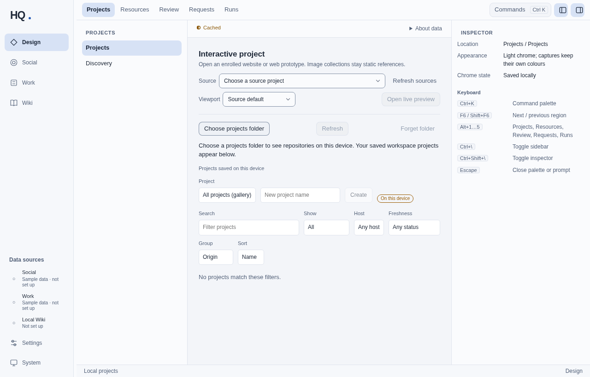

HQ opens straight into Design › Projects. The screen holds about 20 controls: source and viewport pickers, "Choose projects folder", a project picker, Create, six filters, a "Cached" badge, and the line "No projects match these filters." There are no projects at all, so no filter is hiding anything. Nothing on screen explains:

- the four domains;
- that Social and Work are showing sample data kept only for this session;
- that the Wiki needs a local repository;
- which first step matters.

Linear, Things 3 and Arc each open on a short, skippable welcome that leads to the first meaningful action. HQ's rail already knows the setup state ("Sample data · not set up", "Not set up").

- **F7:** a first-run welcome and getting-started checklist built from the live data-source state, dismissible and reopenable from ⌘K.
- **F4/F5:** a true empty state for Projects ("No projects yet. Create one, or choose a projects folder."). Hide the filters while there is nothing to filter. Don't show "Cached" before anything has loaded.

#### X2. ⌘K and search stop at the Design boundary (F7; F4 to coordinate)

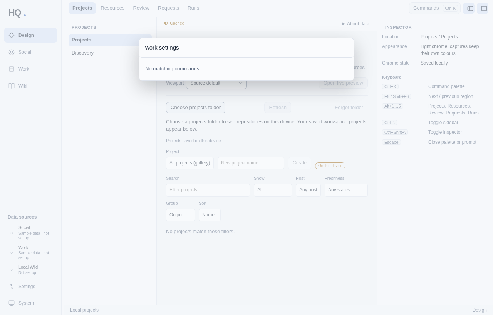

In Design, Ctrl/⌘K opens a good palette, but its commands cover only Design sections and panels: typing "work settings" returns "No matching commands". In Social, Work, Wiki and Settings, Ctrl/⌘K does nothing. Nothing searches across Social drafts, Work cards, Design projects or Wiki pages. The reference port can already do this (`find(query, scope)` over every provider), but only the per-item "Link to…" picker uses it. Raycast and Linear treat ⌘K as the one way to get anywhere; HQ's is local to one module.

- **F7:** a shell-level palette that works in every domain. It will offer going to any domain or section, Settings categories, appearance, the welcome, and search across HQ through the reference providers. Results open through the existing reference navigation, so Back works.
- **F4:** Design's palette keeps Ctrl/⌘K while focus is inside Design (the shell yields to `event.defaultPrevented`). Either add the shell's cross-domain commands to it, or hand ⌘K to the shell palette and register Design's sections there. One palette is the target.

#### X3. Service status has three sources that disagree (F1 shell banner, F6 data sources)

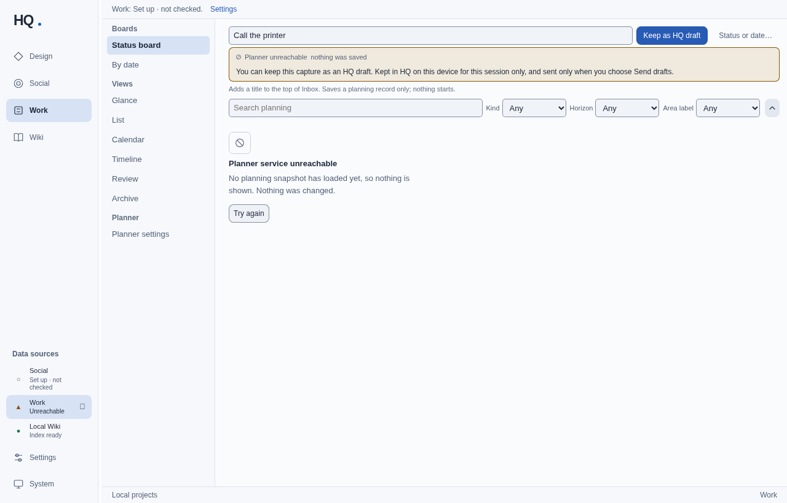

- **Live and working.** The Work banner still reads "Work: Set up · not checked." (`apps/desktop/src/services/domains.tsx` builds it from configuration, not from what was observed).
- **Unreachable.** The module says "Planner service unreachable". The rail says "Set up · not checked" until someone presses ↻; then the rail says "Unreachable" while the banner still says "Set up · not checked".
- **Dropped mid-session.** Work correctly shows "Offline · last synced 8:34 AM · changes paused", while the banner and the rail stay at "not checked".

Fix: one observed-status store per service, fed by module outcomes and by a quiet check at launch and on focus. Render it as one compact status pill in the domain header ("Live · synced just now", "Offline · showing 14:02 snapshot"), mirrored in the rail. Raise F1 toasts only on transitions ("Work is back online", "Social is unreachable · showing last snapshot").

#### X4. Full-pane error screens in Social and Wiki (F3, F6)

| Social, service unreachable | Wiki not set up, search |
| --- | --- |
| 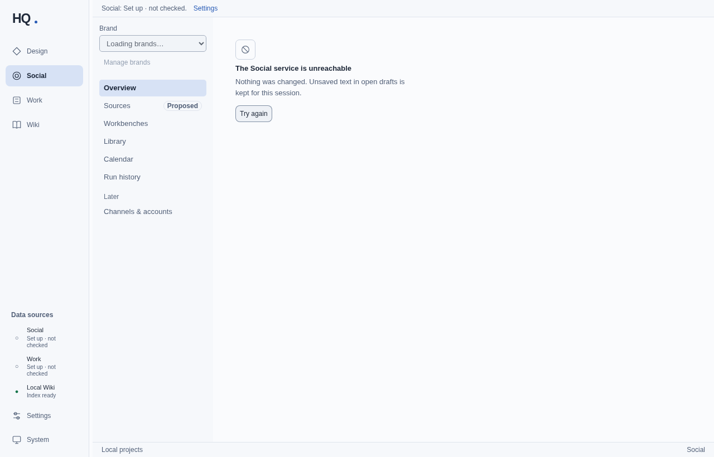 | 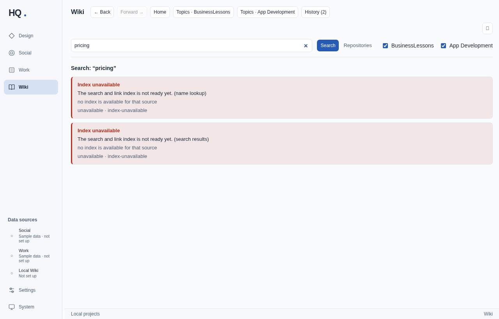 |

- **Social.** An unreachable service replaces the whole Social content area with one message and a Try again button, and the brand picker hangs at "Loading brands…".
- **Wiki, not set up.**
  - The home page lists two hard-coded repositories, each saying "No source information is available for this repository".
  - Search shows two red error panels with internal codes ("unavailable · index-unavailable", "(name lookup)", "(search results)").
  - Nothing links to Settings › Data sources › Local Wiki.

The model is Work:

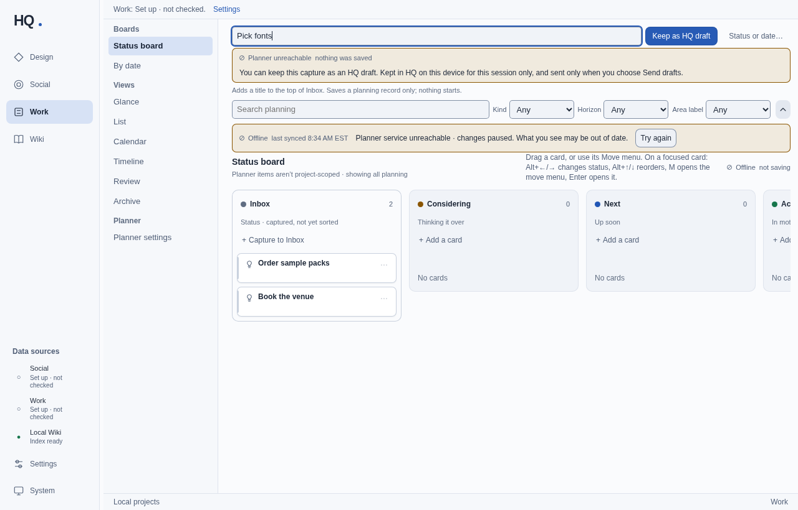

Work keeps the last snapshot and adds an inline "Offline · last synced … · changes paused" bar with Try again. A capture made offline becomes "Keep as HQ draft" instead of failing. Social and Wiki should adopt the same pattern with F1's `InlineNotice`, `StatusIndicator` and toasts. When the Wiki isn't set up, it should show a set-up empty state, not an error.

#### X5. Cross-module references can't be seen on first launch, and the way back is broken (F7 for navigation; F2/F3 for sample data)

| Sample references are read-only | Back from a reference |
| --- | --- |
| 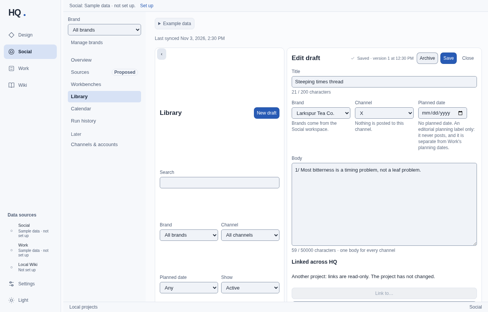 | 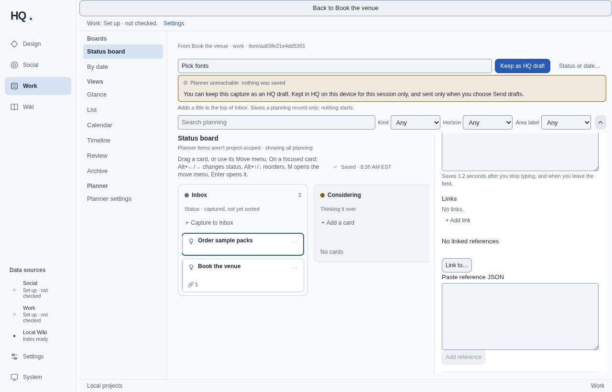 |

**Sample data.**

- Social's sample references point at project `fixture-project`, but the shell's project is `hq-local`. The editor says "Another project: links are read-only", and both Open buttons are disabled.
- The Social overview says "Opening Design or Work records from here arrives with HQ references", although HQ references are already live.
- Work's sample card links only to an external URL, and says "Planner does not advertise hq-references-v1".

So a new user never sees Social and Work link to each other, the most distinctive cross-app flow in HQ.

**Navigation.** When a reference does open (scenario C, Work card to Work card), the shell's way back is a full-width, browser-default "Back to Book the venue" button. It pushes the whole page down 34 px, has no keyboard shortcut and no transition, and sits apart from the module's own "From Book the venue · work · item/aa59fe21e4dd5301" line. The read-only reference notice is also unstyled.

- **F2/F3:** make the sample-data references use the active project, and pair one sample Social draft with one sample Work card.
- **F7:** a compact Back pill in the domain header with Alt+← (⌘[ on Mac), the read-only notice as an F1 `InlineNotice`, and a short transition that shows where the user landed.

### Medium

#### X6. Narrow windows (F1 rail; F2/F3 detail layouts)

| Work at 760×560 | Social Library at 760×560 |
| --- | --- |
| 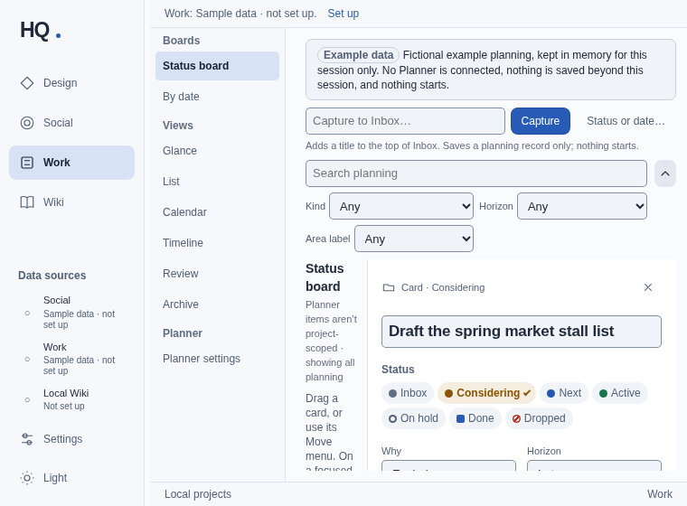 | 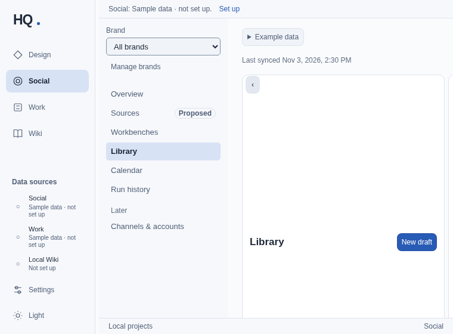 |

At the 760 px minimum, the expanded 160 px rail plus the module's own navigation leave about 450 px of content.

- **Work.** The card detail panel squeezes the board to about 60 px; "Status board" wraps one word per line.
- **Social.** With a draft open, the editor is clipped off-screen. The Library column stretches vertically at every width, putting large gaps between the heading, search and filters (also visible at 1280).
- **Design.** Auto-hides its inspector, which is good.

Fix: the rail compacts automatically below about 1000 px (F1). Detail panels overlay or stack below about 900 px of content width (F2, F3).

#### X7. Keyboard-only use (F7 shortcuts; F1 skip link)

Focus rings are visible (2 px), and Escape closes Settings and returns focus to the button that opened it. But:

- 13 tab stops (four domains, six data-source controls, Settings, appearance, splitter) come before any content, and there is no skip link;
- Ctrl/⌘/Alt+1–4 don't switch domains;
- ⌘, doesn't open Settings, and there is no shortcut reference;
- F6 region cycling and Alt+1…5 work only in Design.

- **F7:** global shortcuts (⌘/Ctrl+1–4 for domains, ⌘/Ctrl+, for Settings, Alt+← for Back), listed in the palette.
- **F1:** a "Skip to content" link, and the rail as one roving tab stop.

#### X8. "Project" means something different in each domain (F1 project switcher; coordination)

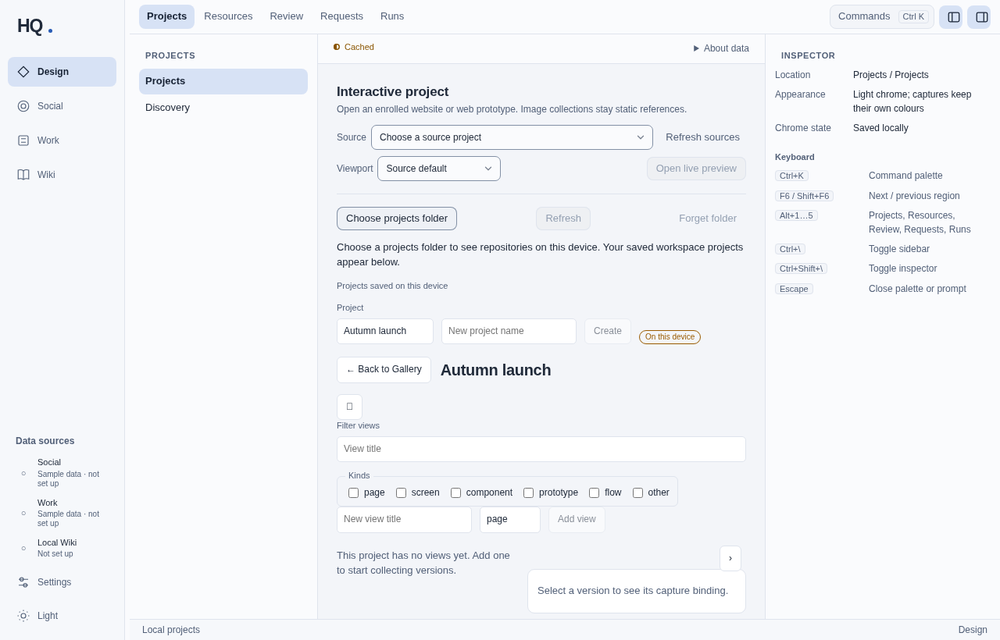

Each domain groups its work differently:

- **Design** has saved workspace projects ("Autumn launch" above) and enrolled source projects.
- **Social** has Brands.
- **Work** has Area labels, "a Planner label, not a project", and "Planner items aren't project-scoped".
- **The shell footer** always says "Local projects". Creating and selecting a Design project doesn't change it; only choosing an enrolled interactive source does. Reference search is scoped to "project hq-local".

A project switcher (F1 scope) needs a clear statement of what switching changes in each domain, shown in the top bar. Domains that aren't project-scoped should say so where the switcher is.

#### X9. The Wiki can't be linked or searched from other domains (F6, shell reference registry)

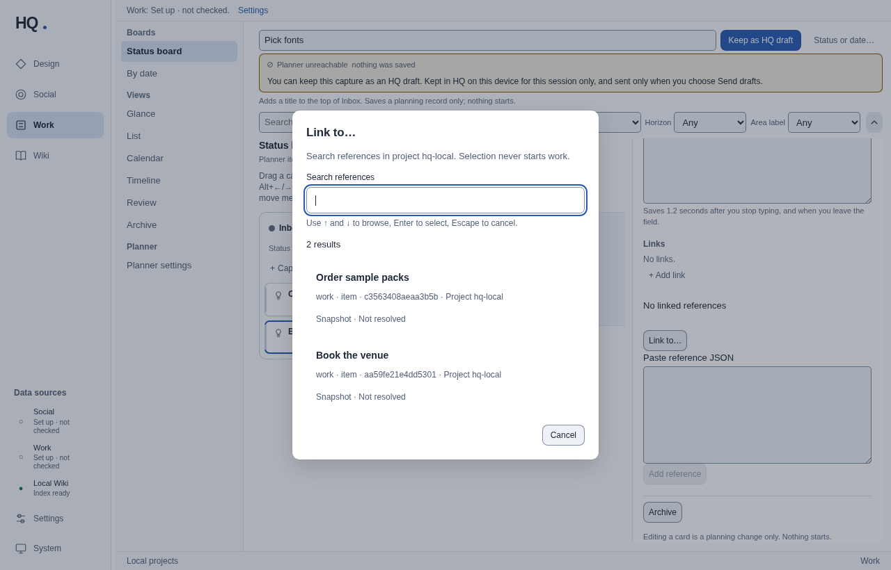

`apps/desktop/src/reference-providers.ts` registers Design, Social and Work, but not the Wiki. "Link to…" in Work or Social can't attach a Wiki page, and cross-HQ search can't find one. The picker shows internal identifiers ("work · item · c3563408aeaa3b5b · Project hq-local · Snapshot · Not resolved") where a user expects title, domain and status. A read-only Wiki page provider (kind `page`, destination = the Wiki page route) would let HQ's knowledge base join cross-module flows.

#### X10. No motion in the shell (F1, in progress)

The shell has no transitions. A domain switch is a hard remount (the React key changes), and Settings appears and disappears instantly. Across all CSS there are 8 `transition` and 11 `animation`/`@keyframes` declarations, none of them in the shell. F1's `PageTransition`, `Presence` and `useListMotion` (`284393d`) are the shared answer. Domain switches, the Settings overlay, the palette and toasts should use them, with `prefers-reduced-motion` honored.

### Low

- **X11. Appearance cycle (F1).** Light → Dark → System. When the OS is light, the System → Light step changes only the label, which reads as a broken button. Use a three-way segmented control or a small menu.
- **X12. Window title (F7).** It is always "HQ". It should name the location (for example "Work · Status board — HQ") for OS window switching and screen readers.
- **X13. Developer text in user flows (F2, F3).** The "Paste reference JSON" textarea, "Serialized HQ reference", raw entity IDs and "Snapshot · Not resolved" appear in the Work card detail and the Social editor. Put them behind an "Advanced" disclosure.
- **X14. Unicode glyphs as icons (F4, F6).** The Wiki header's "⌃" and the Design project toolbar button render as empty boxes on hosts without the glyph. Use the SVG icon set.
- **X15. Stale capture notice (F2).** After the Planner recovers, the capture field keeps "Planner unreachable · nothing was saved" and the "Keep as HQ draft" button until the next submit.
- **X16. Settings › Project sources form (F6).** The "Gallery label" and "Gallery base URL" labels are inline, unspaced and larger than the body text.

### What already works (keep it)

| Dark theme (Social) |
| --- |
| 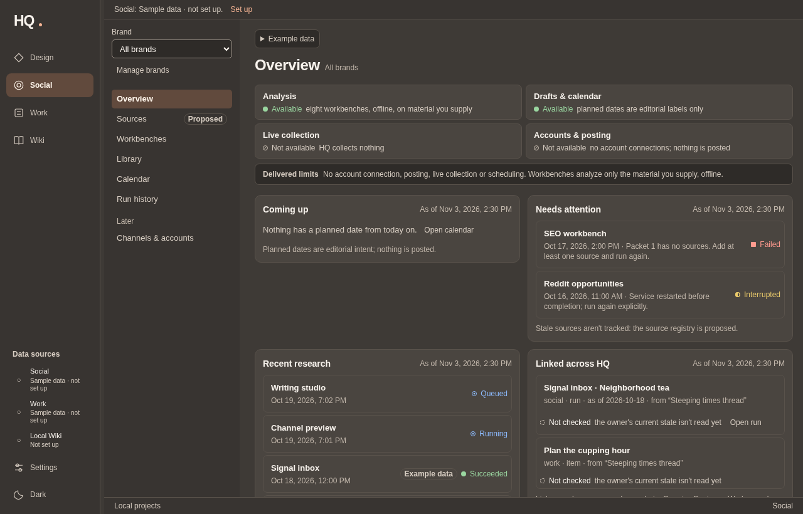 |

- Work's offline model: stale data kept, inline status, drafts that survive an outage, toasts with Undo after capture and move.
- A dark palette that stays consistent across all four domains and Settings.
- Visible focus rings. Escape closes the palette and Settings and returns focus.
- Domain state (filters, selection, unsaved text) survives domain switches, as `social-work.integration.test.tsx` shows.
- Truthful sample-data labels ("Example data · Fictional example planning, kept in memory for this session only").

## Lane routing

| Finding | Owner | Note |
| --- | --- | --- |
| X1 welcome/checklist | F7 | New shell files; single mount point |
| X1 Projects empty state, "Cached" on first launch | F4/F5 | Design Projects view |
| X2 global palette and search | F7 | Shell yields to Design's handled ⌘K |
| X2 one palette | F4 + F7 | Needs agreement; no contract change proposed yet |
| X3 one status store, header pill, transition toasts | F1 + F6 | `services/domains.tsx`, `settings/DataSources.tsx` |
| X4 Social and Wiki inline errors and set-up empty state | F3, F6 | Adopt F1 `InlineNotice` |
| X5 sample references in the active project | F2, F3 | Sample data only |
| X5 Back pill, Alt+←, read-only notice | F7 | Shell return frame |
| X6 rail auto-compact | F1 | |
| X6 detail panels at narrow widths | F2, F3 | |
| X7 global shortcuts | F7 | |
| X7 skip link, roving rail | F1 | |
| X8 project semantics in the switcher | F1 | Needs an owner decision on scope |
| X9 Wiki reference provider | F6 | Registry is in the shell's `reference-providers.ts` |
| X10 shell and domain transitions | F1 | |
| X11, X12, X13–X16 | as listed | |

## F7 fixes in flight

Each builder works on its own worktree from `work/hq-foundation`, adds new files under `apps/desktop/src/`, and keeps its change to `PresentationShell.tsx` to a mount point, so it merges cleanly with F1's shell work. The F7 integration pass merges every lane branch and reports conflicts.

- **F7-B1, global command palette and search:** Ctrl/⌘K in every domain. Commands for domains and sections, Settings categories, appearance and the welcome. Search across Design, Social and Work through the reference providers, opened through reference navigation.
- **F7-B2, first-run welcome and getting started:** dismissible and reopenable. It reads the data-source state and links to each set-up step.
- **F7-B3, cross-module navigation:** the Back pill with Alt+← (⌘[ on Mac), the read-only reference notice, ⌘/Ctrl+1–4 and ⌘/Ctrl+,, and a document title that tracks the location.

Their PRs, review verdicts for the other lanes' PRs, and the integration result will be appended here.
