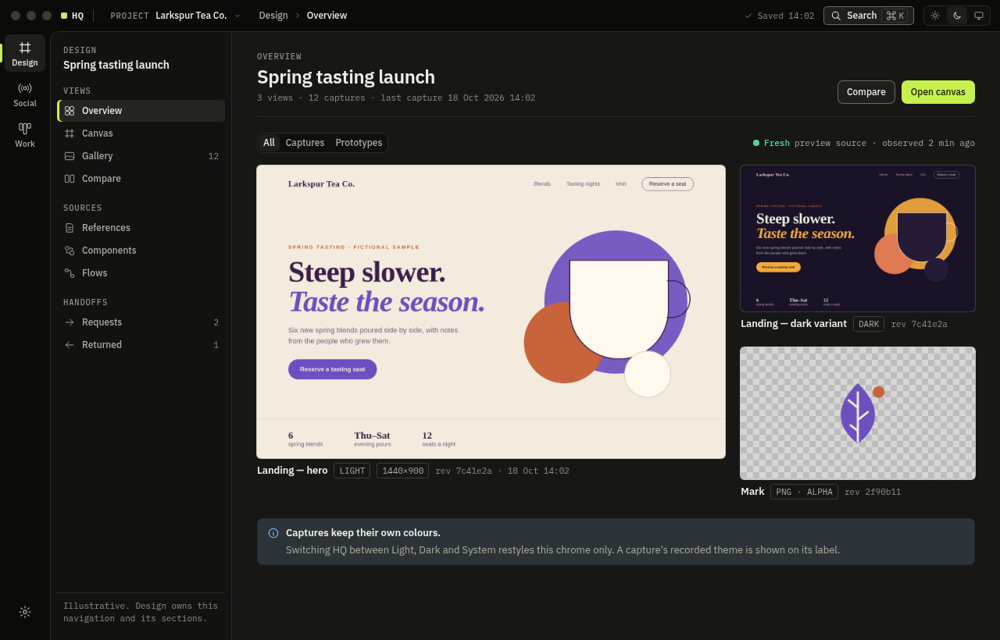

# HQ visual system

Preliminary desktop visual system for HQ's shared chrome: the window frame, the slim domain rail (Design, then Social, then Work), secondary navigation, global appearance and project context, and their component states. It provides light and dark themes, tokens in CSS and JSON, rendered mockups, and an integration note for the shell and module owners.

**Status:** tokens are consumed by `@hq/ui` and the modernization source candidate. Historical mockups and screenshots below document the earlier proposal; they do not prove the current application or installed runtime. The current implementation contract is [HQ UI modernization](../../engineering-specs/hq-ui-modernization.md).



## The direction in one paragraph

The current direction follows Design: cool neutral surfaces, restrained blue selection and accent, compact sans-serif interface text and consistent rounded controls. Status pairs a shape with a word. Captured artwork, exports and previews keep their own appearance. The oversized repeated context header is removed; project context is compact footer text. The primary rail resizes to icons and keeps connections, settings and appearance visible. Appearance cycles Light → Dark → System. Secondary panels resize fully closed with a restore grip.

## Files

| Path | What it is |
| --- | --- |
| [`tokens/hq-tokens.json`](tokens/hq-tokens.json) | Source of truth: 39 colour roles × light/dark, 4 theme-invariant artwork tokens, type, space, radius, size, motion, layering, component roles, contrast pairs. |
| [`tokens/hq-tokens.css`](tokens/hq-tokens.css) | Generated, implementation-consumable custom properties (`--hq-*`). Do not edit by hand. |
| [`tokens/contrast-report.md`](tokens/contrast-report.md) | Generated WCAG ratios for 104 role pairs in both modes; all pass. |
| [`tokens/t0-bridge.css`](tokens/t0-bridge.css) | Maps the T0 shell's current variable names (`--background`, `--surface`, `--accent`, …) to HQ roles. |
| [`components/hq-components.css`](components/hq-components.css) | Reference styling for every component and state, built only from tokens. Geometry reference, not a runtime package. |
| [`mockups/`](mockups/) | Rendered pages: `design.html`, `social.html`, `work.html` (illustrative chrome), `states.html` (all states, light and dark side by side), `artwork.html` (artwork invariance). `?theme=light|dark|system`, `&drawer=open`, `&slots=design` (T0's unavailable Social/Work slots). |
| [`evidence/`](evidence/) | Screenshots, layout JSON and `manifest.json` (SHA-256 of every image plus check results). |
| [`tools/`](tools/) | `hq_tokens.py` (build/check tokens and contrast), `render.sh` (headless Chromium capture), `compare_regions.py` (pixel invariance checks). Standard library only. |

## Historical mockup anatomy and sizes

| Part | Specification |
| --- | --- |
| Window | Minimum 760×560 (T0's `BrowserWindow` minimum); default 1280×820. |
| Titlebar | 40px on `--hq-canvas`. On macOS, a 78px inset for the window controls (12px elsewhere). Left to right: HQ mark, **project context** button (`PROJECT  Larkspur Tea Co. ⌄`), location breadcrumb, then save state, Search (⌘K) and the **Light / Dark / System** radio group. The bar is a drag region; its controls are not. |
| Rail | 64px wide on canvas. 52×48 items: 20px glyph over a 10.5px label, in the order **Design, Social, Work**, with Settings pinned at the bottom. The current item gets a selected fill plus a 3px signal bar at the window edge. An unavailable slot keeps its place but is dimmed and uses a dashed glyph and a tooltip, and stays focusable so it can explain itself. |
| Sheet | `--hq-surface`, hairline top/left border, 12px top-left radius. Holds the secondary nav and the main area. |
| Secondary nav | 232px wide at ≥1280, 204px at 960–1279; on `--hq-nav`. Domain eyebrow and scope title, grouped 28px items with optional counts, current item gets a fill plus a 3px inset bar. A footer is available for domain status. |
| Compact (<960) | The secondary nav becomes a 264px drawer opened from a titlebar toggle (`aria-expanded`). Focus moves into the drawer; Escape or the scrim closes it and returns focus. The appearance control collapses to one menu button, and the breadcrumb shows only the current section. |
| Spacing | 4px base: 2, 4, 6, 8, 12, 16, 20, 24, 32, 48. Controls are 24/30/36px tall; hit targets ≥24px. |
| Type | Plex Sans: display 24/30, title 17/24, heading 14/20, body 13/20, label 12/16, rail 10.5/12. Plex Mono: eyebrow 10.5/14 uppercase +0.08em, meta 11/16 with tabular figures. |

## Historical mockup states covered

[`mockups/states.html`](mockups/states.html) renders each item below in light and dark ([evidence](evidence/states-1440.png)):

- **Buttons** (primary, secondary, ghost, danger): rest, hover, pressed, focus, disabled, busy (spinner plus a verb in progress; keeps its width).
- **Fields**: rest, focus, invalid with message, disabled, read-only. **Appearance** radio group.
- **Rail items**: rest, hover, current, focus, unavailable. **Nav items**: rest, hover, current, focus. Tooltip.
- **Source freshness**: fresh, stale, unknown (dispatch not confirmed), unavailable.
- **Saving** (SaveIndicator in the T1 plan's RS-3): saved, saving, unsaved, failed with retry, offline (kept on this device), unknown result with check. Saving is local persistence only, never execution.
- **Feedback**: info (different project), warning (stale), danger (save failed) banners; undo toast.
- **Panels** (StateView in RS-3): empty, loading skeleton, error, offline, unavailable, unknown.
- **Work card**: rest, hover, selected, focus, dragging, drop position. **References**: same project, other project (worded, plus a warning edge), missing target (dashed border, readable snapshot kept).

## Integration note

These are proposals for the owners named below. This lane edits only `docs/design/hq-visual-system/`. The T1 plan candidate (`spec.hq-social-work`, PR #3, unmerged) gives final role values to this artifact (RS-1); the marker and state names below follow its RS-2 and RS-3.

1. **Tokens (foundation owner).** Load `tokens/hq-tokens.css`, then `tokens/t0-bridge.css`, and remove the palette blocks from `apps/desktop/src/styles.css`. T0 already writes the resolved theme to `<html data-theme="light|dark">`, which is the selector the tokens use. Before React mounts, `:root { color-scheme: light dark }` follows the OS, so System renders correctly on first paint. Colour roles are `light-dark()` pairs, so a `[data-theme]` subtree resolves its own scheme. Shadows switch through explicit blocks because `light-dark()` only accepts colours.
2. **Fonts (foundation owner).** Bundle IBM Plex Sans 400/500/600 and Plex Mono 400/500 (SIL OFL 1.1) as local woff2, which the CSP's `font-src 'self'` allows. The mockups load them from Google Fonts for preview only. The fallback stack (`system-ui` / `ui-monospace`) keeps the layout intact but loses the mono/sans contrast that carries provenance.
3. **Window (foundation owner).** Replace the fixed `backgroundColor: '#17191d'` with the canvas colour for the resolved theme (`#E6E5DD` light, `#0B0C0A` dark) so a light launch doesn't flash dark. If the titlebar layout is adopted, use `titleBarStyle: 'hiddenInset'` on macOS with `-webkit-app-region: drag` on `.hq-titlebar` and `no-drag` on its controls.
4. **Shell chrome (modernization coordinator).** The owner superseded the titlebar proposal: use a cycling appearance button in the pinned rail footer, compact project text in the content footer, and no repeated domain/project header. The rail drags to 64px icons; secondary panels collapse to zero with restoration. Design's compact primary tab row stays available.
5. **Preserved content (Design and every module that shows captures).** Mark captures, exports, artwork and producer previews with the RS-2 marker `data-hq-content="captured"` (or `"producer"` / `"export"`; add `data-hq-matte="checker"` for a fixed transparency grid). The token CSS styles any `[data-hq-content]`. Set `--hq-content-scheme` to the content's *recorded* theme through CSSOM (`el.style.setProperty`), since the CSP `style-src 'self'` blocks inline style attributes. A local probe in Chromium 155 found that an iframe's `prefers-color-scheme` follows the owner element's used `color-scheme`, not the OS. An SVG used as an `` follows it too. Without this pin, switching HQ to Dark would silently re-theme a light preview. Never apply filter, blend mode or opacity to preserved content, and keep the matte constant.
6. **Module chrome (all domains).** Use `--hq-*` roles for chrome only. Domain-specific colours (for example, Work's Manual Planner status hues) stay domain-owned under `--design-*`, `--social-*` or `--work-*` prefixes. Pair every status colour with a word and a shape.
7. **Records stay distinct (Work, Design, Social).** Reference blocks name the owning domain in a mono eyebrow, a title snapshot, and kind/revision or "Other project · …". Execution records use the same block with a freshness line ("Running · observed 4 min ago", "Unknown · host unreachable 13:20"). Card moves confirm "Planning change only · no run started" with Undo.

## Historical mockup evidence

The results below apply to the earlier warm/lime mockups and their recorded revision. Token values and current application geometry have since changed; regenerate current evidence before asserting the same results.

The checks ran on Linux with headless Chromium 155 at device scale 1, with Plex fonts loaded on every page (`plex_fonts_loaded` in [`evidence/manifest.json`](evidence/manifest.json)).

| Check | Result |
| --- | --- |
| `python3 -I tools/hq_tokens.py check` | Generated CSS and report are current; 104/104 contrast pairs pass in both modes. |
| `python3 -I tools/compare_regions.py` | 13/13 pass: each preserved well has **identical pixels** in light and dark chrome (artwork page and Design page). The 1:1 wells equal the source PNG's pixels. System with OS dark/light renders the same as explicit Dark/Light (only the appearance control differs, because it shows "System"). A negative control confirms the chrome itself differs. |
| Live preview at 1280 and 760 | System followed an emulated OS change live. Explicit Light overrode OS dark. The dark capture's well kept `color-scheme: dark` in light chrome. The drawer opened and closed with focus moved in and returned; keyboard focus rings were visible ([capture](evidence/live-preview-760-drawer-keyboard.png)). |

The earlier render exposed a resampling seam: the same downscaled capture at two different page offsets differed in 561 of 269,280 pixels (max channel delta 11). The artwork page now shows captures 1:1, and the scaled comparisons are taken at identical positions.

Screenshots: Design [dark](evidence/design-dark-1280.png) / [light](evidence/design-light-1280.png) / [760 dark](evidence/design-dark-760.png) / [760 light, drawer open](evidence/design-light-760-drawer.png); Work [dark](evidence/work-dark-1440.png) / [light](evidence/work-light-1440.png) / [760](evidence/work-dark-760.png); Social [dark](evidence/social-dark-1280.png) / [light](evidence/social-light-1280.png); [states](evidence/states-1440.png); [artwork invariance](evidence/artwork-invariance-1440.png).

**Not verified:** Electron or macOS rendering, SF Pro fallback rendering, real window controls, screen readers, forced-colours mode, and Retina (2×) captures. Contrast figures are WCAG 2.x calculations, not perceptual testing.

## Reproduce

From `docs/design/hq-visual-system`, with `python3` and `chromium` (network access is only needed for the preview fonts):

```sh
python3 -I tools/hq_tokens.py build     # after editing tokens/hq-tokens.json
python3 -I tools/hq_tokens.py check
tools/render.sh evidence                # writes evidence/*.png and evidence/layout/*.json
python3 -I tools/compare_regions.py     # writes evidence/manifest.json; exits non-zero on any failed check
```

`tools/render.sh artwork` regenerates the fictional artwork PNGs from `mockups/assets/src/`. Run it only when the artwork changes, because the PNG bytes are the reference the checks compare against. To browse the mockups, serve this directory over loopback (for example `python3 -m http.server --bind 127.0.0.1`) and open `mockups/design.html?theme=system`.

All names, brands and content (Larkspur Tea Co., Atlas Weekend Market) are fictional.
