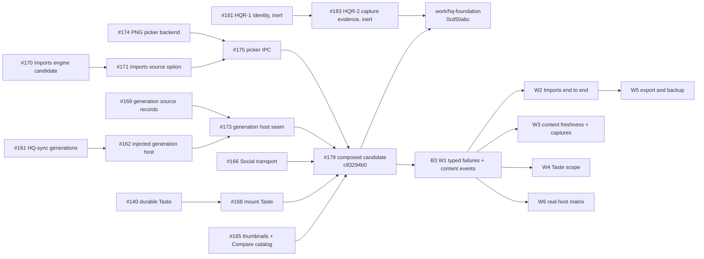

# Design backend assessment and implementation spec (2026-11-03)

Artifact Type: engineering-spec

Artifact ID: `spec.hq-design-backend`

Purpose: Assess what HQ Design specifies, implements and tests in its data and backend layers. Triage the open Design backend PRs, propose a merge order, and specify the workstreams that make every Design section work end to end against real local storage, with typed failures the views can show.

Specification owner: HQ backend lane B3 (Design data and backends)

Decision owner: M Jones

Consumers: HQ integration owner (T1); frontend lanes F4 (`work/hq-life-design-core-20261103`) and F5 (`work/hq-life-design-sources-20261103`); B3 builders and reviewers

Authority effect: none

Status: progressive. Sections marked *target* describe B3 work in flight. The delivery record at the end names what actually landed.

## Summary

<!-- codex-section:begin id="spec.hq-design-backend#ctx.summary.001" -->
Design's backend is further along in source than the desktop app shows. These pieces are implemented and tested:

- the durable T9 file store (`packages/design-store`);
- a gated transaction engine with recovery and repair;
- a privacy-projected export;
- durable storage for Projects, Components, Flows, Compare, Annotations, Canvas, References, Requests and the connector outbox;
- durable project-bound Taste;
- a bounded PNG picker;
- Imports storage over the transaction engine.

Four things keep Design from working end to end:

1. **Wiring left default-disabled on purpose.** Imports storage, the file picker and export are built, but the desktop never turns them on. The Imports view still runs on a labelled in-memory fake with a synthetic two-image source.
2. **Composition gaps.**
   - The durable workspace caches each project's content forever, so a new capture or import does not appear until restart.
   - Annotations opens the first version and has no capture image.
   - Captured versions have no thumbnail.
   - Compare lists no captures.
3. **Untyped failures.** Views receive raw `Error` messages, and a refusal from the host's `disabled` routes was misreported as an unknown outcome.
4. **Two deferred Taste findings** (#168): a stale content snapshot, and general-scope collisions between projects that reuse a version ID.

B3 fixes these in source:

- W1 adds typed failures and project content events.
- W2 enables Imports end to end.
- W3 keeps content current and shows captures.
- W4 fixes Taste scoping.
- W6 proves every section through the real host.

B3 enables Imports by default, because it is local, atomic and recovery-qualified. B3 keeps disabled whatever reads outside HQ's data directory or reaches the network: the generation sources, live Jones Code sends, the component runner and the project identity cutover.
<!-- codex-section:end id="spec.hq-design-backend#ctx.summary.001" -->

## Evidence read

- HQ `work/hq-foundation` at `0cd50abc974320771cc21145dc8a8fd58a3eb8b1`.
- PR #179 head `c83294b0309f830fc15e7af31348978a521292d4`. It is the composed candidate that contains #140, #161, #162, #165, #166, #168, #169, #170, #171, #173, #174 and #175.
- PR #181 head `73c1acf0` and PR #183 head `1202904f`.
- Source read:
  - `apps/desktop/electron/{design-host,main,preload,services,import-picker,catalog-host,save-dialog}.ts`, `apps/desktop/electron/preview/host.ts` and `apps/desktop/electron/jones-code/host.ts`;
  - `packages/contracts/src/{services,design-records,preview}.ts`;
  - `modules/design/app/{compose,storage}/**`;
  - every section's `src/` and README under `modules/design/`;
  - `.github/workflows/design-sections.yml` and `tests/check-groups.toml`;
  - `docs/prds/design.md` and `docs/engineering-specs/{design,hq-bootstrap}.md`.
- Every PR body named in the triage below.
- All 39 `work/hq-design-*` and `review/hq-design-*` branch heads. Each one is an ancestor of `work/hq-foundation`.
- Frontend lanes at assessment time:
  - F5 had pushed `work/hq-life-design-sources-20261103` with its Sources assessment and file-ownership plan, but no PR.
  - F4 had published neither a branch nor a PR.

## Inventory: specified, implemented, tested

<!-- codex-section:begin id="spec.hq-design-backend#ctx.inventory.001" -->
"Durable" means that the desktop app's bridged workspace reads and writes the real local store through `hq:svc:design`. Each section's tests are the rows in `.github/workflows/design-sections.yml`.

| Section | Specified | Implemented (at #179) | Durable in the desktop app | Tested | Gap → work |
| --- | --- | --- | --- | --- | --- |
| Projects (registry, content, versions) | design.md T2, PRD Projects | Provisional local registry and the content repository with CAS | Yes | Section node tests and compose tests | Content cached forever per project; no typed errors → W1, W3 |
| Gallery (inside Projects) | PRD Gallery | Thumbnails resolve through `blob.get` (#165) | Yes, for versions with a thumbnail | #165 tests | Captured versions carry no thumbnail → W3 |
| Captures (live preview) | hq-expansion.md live preview, HQR-2 | Viewport capture into a blob, then a project version `capture-<digest>` | Yes | Interactive compose tests | No thumbnail; other readers never learn of the new version → W1 (events), W3 |
| Compare | design.md T4 | Durable comparisons; the catalog lists project versions (#165) | Yes | Compare and compose tests | `captures: []` until full-extent capture and HQR-2 receipts (owner-held) |
| Canvas | design.md T3 | Durable arrangement with CAS | Yes | Canvas and storage tests | None found |
| Annotations | design.md T5 | Durable documents | Partly | Annotations tests | Always opens `versions[0]`; no capture bytes ("Capture bytes unavailable") → W3 |
| Imports | design.md T13 | Importer, undo, conflicts; engine storage (#170, #171); picker (#174, #175) | **No.** Labelled fake store, synthetic source | Section tests; real-host candidate tests for the engine | Production enablement, host roots, bridge port, picker wiring, links into project content → W2 |
| Taste | design.md T7 | Durable journal under one exact key (#140, #168) | Yes | Taste tests | Stale content snapshot; general-scope collisions (#168 P2s) → W3, W4 |
| References | design.md T8 | Durable records and images (closure workspace) | Yes | References tests | Untyped errors → W1, W6 |
| Components | design.md T10 | Durable library and revisions | Yes; the runner is held | Components tests | A duplicate revision was unclassifiable → W1. The runner stays held pending native qualification. |
| Flows | design.md T11 | Durable flows; capture reads through blobs | Yes | Flows tests | Untyped errors → W1, W6 |
| Discovery | design.md T15 | Catalog roots (`catalog.*`), cache under one exact key, previews | Yes, for chosen local roots | Discovery tests | Generation sources stay default-disabled; untyped errors → W1, W6 |
| Requests and Runs (connector) | design.md T6, T12 | Durable requests and event streams; outbox and evidence; desktop Jones Code host (`jonesCode.*`) | Yes, for storage | Requests and connector tests | Live send to Jones Code is owner-held (credentials, live effect). Unchanged. |
| Storage export and backup | design.md T9, storage K1 spec | Privacy-projected deterministic export; host routes `export.preview` / `export.save` | **No.** Disabled in every construction | Storage tests | Enablement and Imports-panel wiring → W5 (after W2) |
| Project identity and capture evidence | HQR-1, HQR-2 | Inert contracts and codecs (#181, #183) | No (inert by design) | Their own tests | Activation is owner-held (D3 cutover) |

There is no Design-wide real-host test. Each section proves its adapter against fakes or doubles. Only the Imports engine has been exercised through the actual host. W6 closes this gap.
<!-- codex-section:end id="spec.hq-design-backend#ctx.inventory.001" -->

## PR dependency graph

<!-- codex-section:begin id="spec.hq-design-backend#ctx.graph.001" -->

The edges are Git ancestry, verified with `git merge-base --is-ancestor`. #179 merges #165 → #168 → #166 → #173 → #175 in that order. #183 merges cleanly into `work/hq-foundation`, into #179 and into W1 (checked with `git merge-tree`).
<!-- codex-section:end id="spec.hq-design-backend#ctx.graph.001" -->

## Triage

<!-- codex-section:begin id="spec.hq-design-backend#ctx.triage.001" -->
| PR | Verdict | Why |
| --- | --- | --- |
| #179 composed candidate | **Land-ready** as the composition vehicle | One candidate for the twelve Design and Social PRs, with a fresh composed CI run. Merging it marks the originals as reachable from foundation. Disposing of those originals is held for owner decision, as its body says. B3 builds on it and does not replace it. |
| #140 durable Taste | Superseded by #168, inside #179 | #168 contains it |
| #168 mount Taste | Inside #179; **needs fixes** | Two deferred P2s. The content-snapshot P2 → W3. The general-scope collision P2 → W4. |
| #165 thumbnails and Compare catalog | Inside #179; land-ready | Captures stay empty until a full-extent capture producer and HQR-2 receipts exist (owner-held) |
| #161, #162, #169, #173 generation sources | Inside #179; land-ready **default-disabled** | They read a binding file outside HQ's data directory and fetch over HTTP. Owner holds G-QUAL, G-AUTH and G-LIVE apply. **Do not enable by default.** |
| #170, #171 Imports storage | Inside #179; land-ready; **should be enabled** → W2 | Local only, with atomic commits, recovery on open and real-host qualification (#170). Export stays disabled until W5. |
| #174, #175 picker | Inside #179; land-ready; **should be wired** → W2 | W2 adds a parent-window dialog and settles a pending pick on close, which is #175's recorded requirement |
| #166 Social transport | Inside #179; outside Design | Lane B2 owns it |
| #181 → #183 HQR-1 and HQR-2 | **Land-ready as inert** | Activation is the owner-held D3 cutover. It is independent of #179. |
| `work/hq-design-*`, `review/hq-design-*` (39 heads) | Historical | Every head is already in `work/hq-foundation` |

**Owner direction.** "The default-disabled pieces should become properly working, enabled features where safe" (2026-11-03). B3 takes this as explicit direction to enable Imports and to fix the P2s that #168's review deferred.
<!-- codex-section:end id="spec.hq-design-backend#ctx.triage.001" -->

## Enable-by-default decisions

| Piece | Decision | Reason |
| --- | --- | --- |
| Imports storage (`openEmittedDesignStore(…, { imports: 'enabled' })`) | Enable (W2) | Local store only, atomic commits, recovery before use, qualified against the real host |
| PNG picker (`import.pick`) | Enable (W2) | Owner-initiated native dialog, bounded reads with no symlink following, no network |
| Design export (`export.preview` / `export.save`) | Enable after W2 (W5) | Read-only on the store; writes a file only where the owner chooses; privacy-projected |
| Generation sources | Keep disabled | They read outside HQ's data directory and use the network; owner holds apply |
| Jones Code live send | Keep as is | Credentials and live effects; owner-held |
| Component runner | Keep held | Needs native qualification (`ac.component-static-enablement.001`, `ac.component-scripted-enablement.001`) |
| HQR-1 and HQR-2 activation | Keep inert | Owner-held D3 cutover |

## Workstreams

<!-- codex-section:begin id="spec.hq-design-backend#ctx.workstreams.001" -->
Each workstream is a branch stacked on W1, built by a delegated builder, reviewed by the lead and reviewed again independently before its PR.

- **W1, typed failures and content events** (`work/hq-b3-design-errors-20261103`, done at `3917ee9`).
  - `compose/errors.ts` maps any backend rejection to a `DesignFailure` with kind, outcome, recovery, section and operation, and maps that failure to toast and inline props. An unconfirmed write offers **Check**, never **Retry**.
  - The bridge keeps the host's `disabled` reason, so a disabled refusal is a definite no-effect.
  - `compose/content-events.ts` lets writers announce project content changes; live capture acceptance notifies.
  - Section errors carry stable names.
  - [`BACKEND-CONTRACT.md`](../../modules/design/app/compose/BACKEND-CONTRACT.md) documents the contract for F4 and F5.
- **W2, Imports end to end** (`work/hq-b3-design-imports-20261103`, *target*).
  - Production opens the enabled store and injects the picker on a parent-window dialog that settles on close.
  - The host reads `design/imports/` through `doc.get`/`doc.list`, and writes it only through `import.commit`.
  - A bridge-backed Imports storage port is added.
  - The picked files become a stable `hq.files` source.
  - Imported images become project versions with thumbnails, preferably in the same atomic commit, and the import notifies content events.
  - Tests run end to end over the real host.
- **W3, content freshness and captures** (`work/hq-b3-design-content-20261103`, *target*).
  - The durable workspace's accessors reload on content events.
  - Views get a one-line revision hook.
  - Annotations gains explicit version selection and capture bytes.
  - Captured versions get thumbnails.
  - The Projects controller refreshes on external writes.
  - Fixes #168's content-snapshot P2.
- **W4, Taste scope** (`work/hq-b3-design-taste-20261103`, *target*).
  - General taste becomes project-qualified, and legacy journals stay readable.
  - Taste failures become typed.
  - Tests cover the journal through the real host.
- **W6, real-host matrix** (`work/hq-b3-design-e2e-20261103`, *target*).
  - One in-process harness: the real host and file store, IPC-shaped cloning, the renderer bridge, and the section adapters.
  - Every section's operations and failure classes are covered, with durability across a host restart.
  - Defects the matrix finds are fixed with regression tests.
- **W5, export and backup** (*planned after W2*).
  - Enable host export in the enabled construction.
  - Route the Imports panel's export to `export.preview` / `export.save` through an additive capability.
<!-- codex-section:end id="spec.hq-design-backend#ctx.workstreams.001" -->

## Proposed merge order

1. #179, the composed candidate. It needs the owner's decision on disposing of the originals.
2. #181, then #183. They are inert and independent; they can also go before #179.
3. B3 W1, stacked on #179.
4. B3 W6 and W4. They touch the fewest shared files.
5. B3 W3, then W2. Both touch `compose/bridged-workspace.ts`. W2 changes production defaults, so it goes last of the four.
6. B3 W5, after W2.
7. This assessment can merge at any time; it changes documentation only.

## Frontend contract

F4 and F5 should build against [`modules/design/app/compose/BACKEND-CONTRACT.md`](../../modules/design/app/compose/BACKEND-CONTRACT.md):

- typed failures and their mapping to the shared `@hq/ui` toast, InlineNotice and StatusIndicator;
- the bridge refusal envelopes;
- project content events.

B3 keeps its edits out of the view files that F5's plan assigns to its builders:

- ImportsPanel and imports.css;
- the Imports, Flows, Discovery and Components views;
- References wiring;
- the taste, references, flows, discovery and components UI folders.

Where B3 must touch a view, it changes wiring only, for example selecting the durable Imports environment or calling the content-revision hook. No markup, layout or style changes.

## Risks and limits

- The development host's root filesystem is 97% full (about 62 GB free). Each builder worktree installs dependencies; B3 skips the Electron binary download to save space.
- Viewport captures are not full-extent captures. Compare stays without captures until the owner-held capture-evidence work is activated.
- Linking imported images into project content is permanent: undo removes import records but keeps the versions, because versions are immutable. W2 documents this.
- None of these changes was installed, deployed or run in the packaged app. Verification is source tests, typechecks and real-host tests in Node.

## Delivery record

*Filled in as B3 PRs open.*
