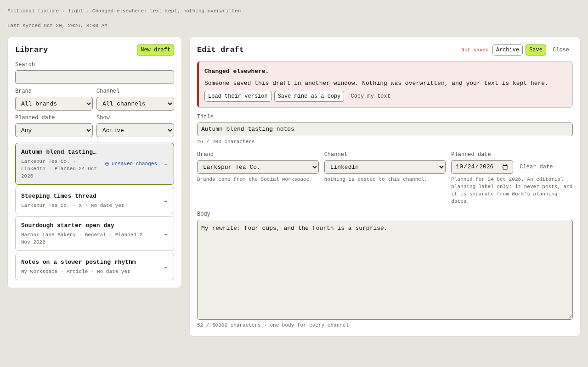
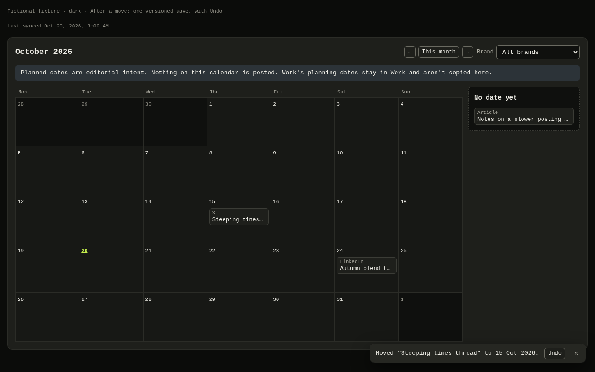
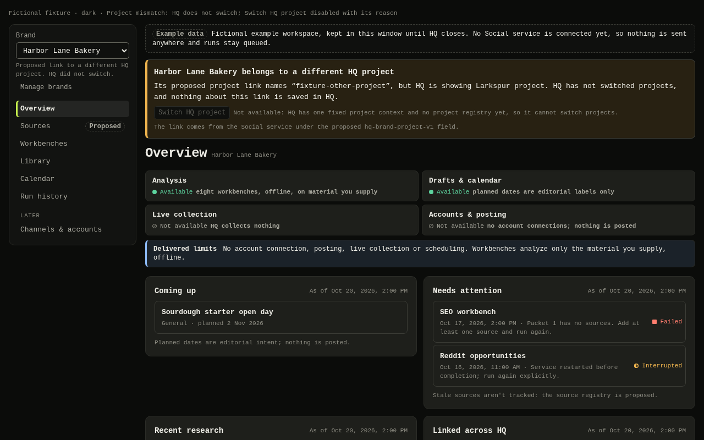
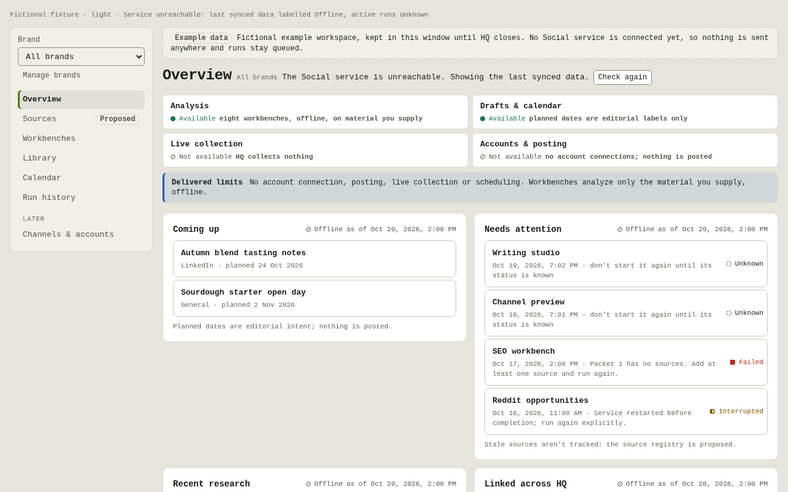
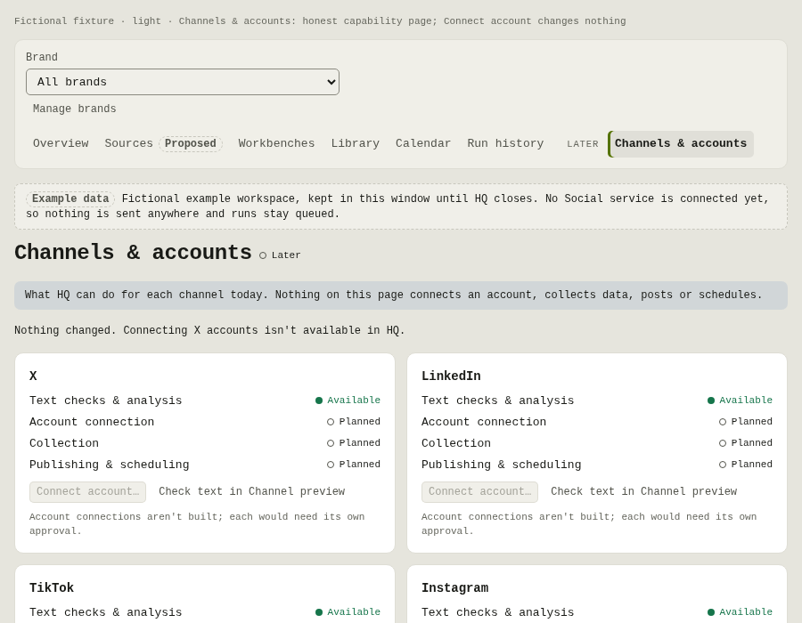

# SOC-C Social core (`task.social-core.001`)

Authority effect: none. This is the lane evidence for `spec.hq-social-work#ac.social-core.001` and `spec.hq-social-work#test.social-core.001`. It produces `spec.hq-social-work#iface.social-port.001`.

## Binding and preflight

| Item | Value |
| --- | --- |
| Branch | `work/hq-social-content`, an isolated linked worktree with one Git owner (this lane) |
| Start | `cfdab378e28940662ddb6e731264afca164a1957` (R1); the accepted foundation `35f9a3e` is an ancestor |
| Plan | `spec.hq-social-work` read at `cfdab378e2…` through the section reader. Sections read: `task.social-core.001` and its context, requires, acceptance and test refs, plus `iface.domain-module.001`, `iface.references.001`, `iface.service-reference-extensions.001`, `ctx.check-catalog.001`, `ctx.test-plan.001` and `ctx.research-decision-basis.001`. R0/R1 evidence was read as Git objects at PR #3 head `d5a34d74b3…`. |
| Codex V3 guidance | The full root `AGENTS.md` was read at commit `4beb491c44…`: blob `3402719bc3…`, 30,716 bytes, SHA-256 `1238a90adb…87ce6`, all verified. Triggered guides applied: CPU telemetry, section reading and delivery. The builder profile is prompt-carried guidance only; no profile isolation is enforced. |
| HQ rules | Root `AGENTS.md`. There is no nested `AGENTS.md` on touched paths. `.agents/shared-guidance.md` is absent, so shared enrollment is unavailable; nothing was installed. |
| Model | Claude Frontier, explicit `claude-opus-5-5` at high effort; no descendants |
| Contributing T3 threads | SOC-C Social content lane, role builder (native ID withheld from this public repository). Coordination owner: HQ root thread. |

**Guidance conflicts.** V3 defaults to delegating qualifying work and to delivering through merge. The owner's no-descendants rule and the HQ merge hold override both. No other conflict was found.

## What `modules/social/core` provides

The module is consumed by relative import from inside `@hq/social` (for example `../core`). No package export changed.

| File | Exports |
| --- | --- |
| `port.ts` | `SocialWorkspacePort` and its record types: `Channel`, `ToolId`, `ToolCategory`, `Brand`, `Draft`, `DraftFields`, `SaveDraft`, `Tool`, `RunRecord`, `RunStatus`, `ObservedRunStatus`, `WorkspaceSnapshot`, `PortError`. Also `PortFailure` (the rejection carrying a `PortError`), `portErrorOf`, `CALL_CLASSES`, `hasFeature`, the constant lists, `DEFAULT_BRAND_ID`, `FEATURE_HQ_REFERENCES`, `FEATURE_HQ_BRAND_PROJECT`, `PROPOSED_SCHEMA` and `MAX_DRAFT_LINKS`. |
| `validate.ts` | Client validation in the service's order, with its messages: `checkDraft`, `checkLinks`, `checkBrandName`, `checkRunSubmission`, `isPlanningDate`, `isRunId`, `isChannel`, `isToolId`. Also `MESSAGES`, `LIMITS` and `MAX_BODY_BYTES`. |
| `fixture.ts`, `fixtures/workspace.ts` | `createFixtureWorkspace({ features, clock, seed, delay })` returns `{ port, controls }`. The controls are `editElsewhere`, `loseNextSubmitResponse`, `failNext`, `setUnavailable`, `advanceRuns`, `restart` and `inspect`. Fictional seed data: `fictionalSeed`, `FIXTURE_IDS`, `FIXTURE_PROJECT_ID`. |
| `recorder.ts` | `recordCalls(port)` returns `{ port, calls(), callsOf(class), clear() }`. Every call is tagged `content`, `read` or `execution`. |
| `runs.ts` | `submitRunOnce` submits once, from an explicit action only, and returns `accepted`, `unknown` or `rejected`. `possibleRunMatches` lists possible matches after an unknown submission. Also `isActiveRun`. |
| `session.ts` | `socialSession(projectId)` and `useSocialSession(projectId)`: module-level state that survives shell remounts. It holds the workspace load (stale snapshots stay visible), draft editors with conflict handling (`saveEditor`, `saveAsCopy`, `reopenLatest`) and page view state. |
| `test/port-conformance.ts` | `describeSocialPortConformance(label, createHarness)` and the `SocialPortHarness` interface, shared by the fixture and live adapters |

**Proposed schema.** `Draft.links` exists only with `hq-references-v1`, and `Brand.project_id` only with `hq-brand-project-v1`. Both come from `iface.service-reference-extensions.001`. They are labeled through `PROPOSED_SCHEMA` and are not delivered service fields.

- The fixture advertises `hq-references-v1` by default.
- `features: []` reproduces today's service.
- Adding `hq-brand-project-v1` makes the seed carry `project_id`, which lets the domain lane demonstrate the mismatch banner.

**Safety invariants checked by tests:**

- There are no network, filesystem or account calls.
- Only `submitRun` is `execution`.
- Loading, editing and saving make zero execution calls.
- A lost `submitRun` response is `unknown`, the port makes exactly one execution call and nothing retries it.
- A conflict never overwrites the other copy, and the user's text is kept.

## Interface research

The research read the private Social workspace service (Fieldnotes) at `3f647daced7fa12f4885222a22ec542bbae6d4e1`. It used Git objects only, under `apps/social_dashboard/` (`server.py`, `catalog.py`, `static/app.js`). Nothing under `data/` and no protected record was read. No source was copied.

- **Mirrored as interface facts:** the validation order and message strings, limits, defaults, conflict semantics, queue capacity, restart interruption and route error classes.
- **Mirrored as catalog identity:** tool IDs, names, categories and marks.
- **Authored for the fixture:** tool descriptions, examples and all records.

**Recorded divergences.** Each entry gives its reason.

1. **Unparseable planning dates.** For a string such as `2026-02-30` or `2026-2-03`, the service returns the CPython `date.fromisoformat` exception text. That text depends on the Python version and does not come from Fieldnotes source. The client returns "Use a YYYY-MM-DD planning date" for every malformed date. **The live adapter must run `checkDraft` before sending** so it passes the shared conformance suite.
2. **`archived: 1.0`.** The service rejects a JSON float. JavaScript cannot represent the difference, and HQ always sends the integer.
3. **Non-text `brand_id`.** SQLite binding fails with a generic HTTP 500. The client returns "Unknown brand".
4. **Ordering edge cases.** Fixture brand order uses UTF-16 comparison where SQLite compares UTF-8 bytes; they differ only above U+FFFF. Ties on equal timestamps sort newest-inserted first, where SQL leaves the order unspecified.
5. **Run outputs and examples.** These are generic fictional shapes. Tool-specific result shapes and the service's structured example files are not modeled; the workbench lane owns that research.
6. **Same-origin and token refusals (HTTP 403).** These are modeled only as an injected `forbidden`, which carries no message, matching the port type.

## Checks

Local, on the exact candidate tree. Each run had fresh telemetry admission first; the last reading before the final runs was CPU 14.46% used and 40.16 GiB RAM available, allowing one serial process. Nothing ran in parallel.

| Command | Result |
| --- | --- |
| `npx tsc -p modules/social/tsconfig.json --noEmit` | Pass |
| `npx vitest run modules/social` (literal `social-module` projection) | Pass: 131 tests in 4 files. That is 129 new core tests in 3 files (two conformance runs, fixture, validation and the session hook) plus R1's 2 skeleton tests. |
| `npm run typecheck` | Pass |
| `npm test` | Pass: 159 tests in 9 files |
| `npm run build` | Pass. It writes only the ignored `apps/desktop/dist*`, which is left in this worktree as classified ignored output. |

**Is the suite sensitive?** As a reversible mutation, the fixture's version check was removed (the backup was restored in place). Four tests then failed: both conformance conflict cases and two session conflict cases.

**Projection.** The `social-module` group is a projection of the group proposed in `ctx.check-catalog.001`. `tests/check-groups.toml` is Design-owned and was not edited.

**Not covered.** No CI is configured, so these are not green CI. There was no Electron launch, and no visual evidence because there is no UI in this task. The suite has not been checked against a live service; that waits for `task.social-live-adapter.001` and D-2 gates.

## Deferred and open items

- **Content task.** `task.social-content.001` was released by root after accepting core at `83dafc5`. Its record is the next section. The nav, index and live paths stay held and untouched.
- **Restart persistence.** `session.ts` is session-only. Persistence across restarts waits for a `ModulePort` storage member (G-3, proposed to the root).
- **No response parsing.** No response-shape parsers exist yet. The live adapter task should validate service responses before trusting them.

# Social content pages (`task.social-content.001`)

Authority effect: none. This is the evidence for `spec.hq-social-work#ac.social-content.001` and `spec.hq-social-work#test.social-content.001`. It covers `req.social-content.001` RC-1 to RC-4 and RC-8. RC-5 to RC-7 belong to the held domain/nav task.

## Binding

| Item | Value |
| --- | --- |
| Core dependency | `task.social-core.001` at `83dafc50ef9e4e1b296baf2f1f9ad2d6b3115f04` (PR #25), root-accepted. Core is read-only in this task; nothing under `modules/social/core/` changed. |
| UI kit dependency | `task.ui-kit.001` at `935dedf78e04a2697bdc02d85864546948ffcb8c` (PR #24: source `1b7dcae`, evidence `935dedf`), root-accepted. It was consumed by one normal, conflict-free merge, `3bc79e1`, authorized by root for this purpose only. No kit file was edited. The kit README and evidence were read before use. |
| Kit limits honoured | Theming is document-level only (`<html data-theme>`); nested-subtree theming is the kit's deferred F1. No inline styles, because the CSP blocks them. These pages have no preserved-content wells. |
| Plan | Sections read at `cfdab378e2…`: `task.social-content.001`, `req.social-content.001`, `ac.social-content.001`, `test.social-content.001`, `iface.ui-kit.001` and `ac.ui-kit.001`. T3 design input read-only at `8f91f6b2…` (`docs/design/social/hq-social-design.md`). |
| Write scope | `modules/social/content/**` and this evidence folder only |

## What `modules/social/content` provides

Consumers import from `modules/social/content`; the nav and index lanes mount it.

| Export | What it is |
| --- | --- |
| `SocialContent({ port, projectId, destination, navigate, now? })` | The content pages for `library`, `library/<draftId>`, `library/new`, `calendar` and `calendar/<YYYY-MM>`. It loads the workspace once per session and shows the loading, empty, error, unreachable and stale states. |
| `Library` | Filters by brand, channel, planned/unplanned, active/archived and search. Rows carry an unsaved-changes chip and an Archive/Restore menu. The draft editor sits beside the list. |
| `DraftEditor` | Fields follow Fieldnotes: title, brand, channel, planned date and one body (RC-8), with character counts. Saving uses `Ctrl`/`⌘` `S`. It shows the save states, the service validation message on the field, the *Changed elsewhere* conflict and the unknown-result check. Links are shown read-only. |
| `Calendar` | A month view plus the *No date yet* tray. Drafts move by pointer drag, or with the keyboard through a dialog offering Move to date, Clear date, Open draft and Cancel. Undo is offered. A note says planned dates are editorial intent only. |
| `BrandManager` | Lists brands and adds one. The built-in brand is labelled present (*Built in*), never created. Exported for the brand switcher, which belongs to the held domain/nav task. |
| `changeDraft`, `reconcileUnknownSave`, `saveStateOf`, model helpers | Pure and helper logic: destinations, filters, the month grid and date labels |

## Calls per interaction

The tests check these with the core recorder. **No content interaction makes an `execution` call.**

| Interaction | Port calls |
| --- | --- |
| Open Social content, first time in a session | `snapshot` |
| Remount after a domain switch | none (the session's snapshot is reused; unsaved text is kept) |
| Create a draft, or save an edit | one `saveDraft` |
| Conflict, then *Save mine as a copy* | one `saveDraft` (refused), then one `saveDraft` that creates the copy. The other copy is unchanged. |
| *Load their version* (after confirmation) | `snapshot` |
| Archive or restore | one versioned `saveDraft` |
| Calendar move, by drag or the dialog | exactly one versioned `saveDraft`, changing only `planned_date` |
| Undo of a move | one more versioned `saveDraft` that restores the previous date |
| Move a draft that has unsaved Library edits | none: the move is refused with a message, so it can never conflict with your own text |
| Unknown save result, then *Check* | one `snapshot`. It never saves again. A save is a separate explicit action. |
| Add a brand | `addBrand`, then `snapshot` |
| Month navigation, opening a draft, filtering | none (destination and view state only) |

## Decisions and recorded behavior

1. **Field changes use the stored record.** Calendar moves and row archive/restore save the stored draft through `changeDraft`, never unsaved editor text. A draft with unsaved edits is refused, and a clean open editor is closed so it reopens from the saved record.
2. **The editor's Archive saves the open text.** It saves the text together with the flag in one versioned save, as the service's own editor does. A failed save leaves the flag unchanged.
3. **Copy lands under its own ID.** After *Save mine as a copy*, the session rests the editor on the copy, so the page navigates to the copy's ID and closes the editor under the original key.
4. **Unreachable service.** Data stays visible, labelled *Offline · showing data last synced …*. Saving, archive and moves pause, and text is kept. *Check again* reloads only; it never retries a save.
5. **"Kept" means this session only.** Unsaved text is kept in memory for the session, not on the device. Persistence across restarts waits for G-3.
6. **Honesty copy.** No *scheduled*, *published*, *posted* or *connected* status is shown. A test asserts the calendar has none of these words.

## Checks

These ran on the candidate tree after fresh telemetry admission: CPU 8.89% used, 44.0 GiB RAM available, one serial process.

| Command | Result |
| --- | --- |
| `npx tsc -p modules/social/tsconfig.json --noEmit` | Pass |
| `npx vitest run modules/social` (literal `social-module` projection) | Pass: 173 tests in 6 files (42 new content tests in 2 files) |
| `npm run typecheck`, `npm test`, `npm run build` | See the PR body for the final head |

**Mutation checks** (each reverted afterwards):

- Removing the unsaved-edit guard in `changeDraft` failed the refusal test.
- Removing the archive-flag revert failed its conflict test.

**Projection.** The `social-module` group is a projection of `ctx.check-catalog.001`. `tests/check-groups.toml` is untouched.

## Visual evidence

The evidence page is `modules/social/content/preview/`. It runs under the exact CSP of `apps/desktop/index.html`, uses only the fictional fixture, and drives each state with real DOM events.

To reproduce, from the repository root:

```sh
npx vite build --config modules/social/content/preview/vite.config.ts      # writes the ignored preview/dist/
npx vite preview --config modules/social/content/preview/vite.config.ts    # http://127.0.0.1:4184/?theme=light|dark&view=<name>
```

**Views:** `library`, `unsaved`, `saving`, `conflict`, `invalid`, `offline`, `empty`, `loading`, `error`, `calendar`, `calendar-move`, `calendar-moved` and `brands`.

**Capture method:** headless Chromium 155.0.8059.79, driven from the command line with `--screenshot` and `--virtual-time-budget=4000`, without an automation protocol. Every view was confirmed to reach its ready marker with `--dump-dom`. Captures are 1280×800 in light and dark, plus 900×700 for the library and calendar. The loopback preview server was stopped afterwards.





| File | SHA-256 |
| --- | --- |
| `captures/brands-dark.png` | `1044467410abbff480ce2c785744beea6180326c63fdde46f96fd6e4464053e7` |
| `captures/brands-light.png` | `e0999bf319f0e89d659b96feaa2ba09a10e2bba4aaaf31d414dc3505a85b9ebb` |
| `captures/calendar-dark-900.png` | `843ac286efad90d5c7461b8c30389c7413b2ea7177af37e79c316724b5c3e965` |
| `captures/calendar-dark.png` | `33d468bec6fb96e583ac0aff59ce181a2ab8831e0f82f52311811aee2806b203` |
| `captures/calendar-light-900.png` | `b8150951384acaf8090a46811c2172e6e446d04d8bb6e83388a8eed0b3346b53` |
| `captures/calendar-light.png` | `785652450fbc0c235c014ab99706c5d72bea4bd0b6b8255755f88990fecb8635` |
| `captures/calendar-move-dark.png` | `3728e327d139d11f0558f51f27105c77028d7ec614c634788c2ab90e07772a2b` |
| `captures/calendar-move-light.png` | `772c1b6a0ac81c74ac3d23af72608e8b437a3fb6f6aeb3acb5298e2fc7bc7b70` |
| `captures/calendar-moved-dark.png` | `0a88f18b6d03e47c8c7a827b58beb939e671eb0f51aeb36103422ca15753347c` |
| `captures/calendar-moved-light.png` | `4c0f147642e677785b866fb57f0674f03225b4da2c4e466042f1e8b8c6100eed` |
| `captures/conflict-dark.png` | `a9da5f0229e993ba00f616e19a6ed56d4969355d3d1033d08e45761c6710341d` |
| `captures/conflict-light.png` | `9943aec9a9669addcc1871f853702b2e0025a2f9afb121cfcce8880b1fbdec8e` |
| `captures/empty-dark.png` | `d249e03ab6f90858c3d765f9cb05b7cb788520a3a0010489cfdec347a5d007db` |
| `captures/empty-light.png` | `5731e259b22de0b32a9ffdb4eef4fbfb192e9f6ef74d3b7a074b626c343a7bc1` |
| `captures/error-dark.png` | `be371cbcb914bd0bf27eac0b99dfd79ed7d09ec780929a4dbe89a9afbf224f96` |
| `captures/error-light.png` | `526a996a42184f7b0b9f81c9f733f9536369990e93311bd8a04f5106d1c8cc97` |
| `captures/invalid-dark.png` | `aec9056f36dff42a7996b5ef4b10f4bdc4d1ecad167b06adda367ad9a573c5ce` |
| `captures/invalid-light.png` | `97ee96d7ed51f6fb7ff95f8b55b31ea2d2d3f42f053fac3059469eb0214e6c47` |
| `captures/library-dark-900.png` | `a70c61775e4e8427f89c90b672e423550de72c81259d9e0869e38f9da9f374f8` |
| `captures/library-dark.png` | `a071afb7d07ec7dcb66971116e52f8a7cd2df7c1bbc199cda6b0cc99e203ff72` |
| `captures/library-light-900.png` | `646c7075a8bd508ed4d2acd971fe51d60c80f4dc58ddb8ca30c9264b1bb539ee` |
| `captures/library-light.png` | `8576ffe7bfca711e57f81a6e0cbb1b82219b3b3e727150fbcc82297fa270d6ce` |
| `captures/loading-dark.png` | `2565ded0759f74d02f2a84655c2bcbe0310606c021571e0226d149f90bb65067` |
| `captures/loading-light.png` | `cba4e42eedce5dde78e55cb89287626e337a67fdf7e9b86937eb20a41efcf592` |
| `captures/offline-dark.png` | `0b707b7089cafced4731c16752ee6dc99eeea85b35f6997d7d61393fda561182` |
| `captures/offline-light.png` | `c54ea8952497a00094130e49933ce254ca4d028fb36b55790d36f4b50efc351e` |
| `captures/saving-dark.png` | `691da3d95baec0a74a5e8386aaf8d33061eeeb5260b1a9b47e3f2aac558ef4a2` |
| `captures/saving-light.png` | `47872d32c75863997974903238c67cae2d5eae544499ce978d66e878938f4f7e` |
| `captures/unsaved-dark.png` | `aa40e90ebeabe8d5bfdd9df2162a009aeb4619c7ebaa84637415a39cfa86c32e` |
| `captures/unsaved-light.png` | `ea4c3a46e1e4fe58938d9182861030f0e1e78fbf4c1e63a95b48d26e1f11a61a` |

**Not covered.**

- **Fonts.** The host renders a monospace fallback face, because IBM Plex is not shipped (the kit's font gate). Type therefore differs from T2's mockups.
- **Scale.** No 2× capture.
- **Platforms.** No Electron and no macOS.
- **Assistive technology.** No screen reader and no forced-colours check. Roles, names and keyboard paths are asserted in happy-dom only.
- **Reduced motion.** Not rendered with the preference on.
- **Pointer drag.** In a real browser, drag was proved only by the happy-dom test with a stubbed `elementFromPoint`. The capture shows the keyboard dialog path instead.

## Deferred

- The core P4 items stay deferred, as root directed: key-order sensitivity in `isDirty`, and the shared in-flight `load`.
- **P4.** The move dialog defaults an undated draft to the first of the visible month, not today.
- **P4.** Unknown-save reconciliation for a *new* draft can only offer an exact-text possible match; it cannot prove the match.
- **P3.** The pointer drag has no auto-scroll and no live drop-target highlight. The keyboard dialog is the complete alternative.

# Social domain (`task.social-domain.001`)

Authority effect: none. This is the evidence for `spec.hq-social-work#ac.social-domain.001` and `spec.hq-social-work#test.social-domain.001`. It covers `req.social-content.001` RC-5 to RC-7, `req.foundation-binding.001` and the SOC-1 and SOC-8 slices of `ctx.social-design-reconciliation.001`.

## Binding

| Item | Value |
| --- | --- |
| Base | `work/hq-social-workbench` at `bffd43343e83173f6814db7771ca6f5b70536494` (SOC-W `task.social-workbench.001`, PR #27), root-accepted. It contains the accepted content `5f5df2a`, core `83dafc5` and UI kit `935dedf`, all verified as ancestors. |
| Task branch | `work/hq-social-domain`, created fresh at `bffd433` with `git switch --no-track -c` in the same physical worktree, `/home/malcolmjones/.t3/worktrees/HQ/work-hq-social-content`. |
| Native binding | The native T3 thread still labels this worktree `work/hq-social-content` (same physical path). Root accepted the physical branch under decision `hq-social-domain-physical-binding-acceptance-20261020-r1`: the label is stale metadata, not a second writer. It was not repaired. Every Git operation used `git -C <path>` with the symbolic HEAD and status verified first. |
| Untouched refs | Local and origin `work/hq-social-content` stay at `5f5df2a`. Origin `work/hq-social-workbench` stays at `bffd433`. PR #25 and PR #27 are untouched. |
| Write scope | `modules/social/index.tsx`, `modules/social/nav/**` and this evidence section. Root later transferred the R1 integration test `modules/social/skeleton.test.ts`, which pinned the replaced stub, to this task. Core, content, workbench, UI, apps, contracts, config and lock are unchanged against `bffd433`. |
| Plan | Sections read at `bffd433`: `task.social-domain.001`, `test.social-domain.001`, `ac.social-domain.001`, `iface.domain-module.001`, `iface.ui-kit.001`, `req.social-content.001`, `req.safety.001`, `req.foundation-binding.001`, `ctx.social-design-reconciliation.001`, `ctx.check-catalog.001` and `ctx.test-plan.001`. T3 design input read-only at `8f91f6b2…`. |

## What it provides

| Path | What it is |
| --- | --- |
| `modules/social/index.tsx` | `SocialModule(props: ModulePort)`, the registry entry (named export, as `apps/desktop/src/modules.tsx` imports it, and default export, per `iface.domain-module.001`). It takes exactly T0's `ModulePort`, with no added members. It mounts `SocialDomain` on the one module-level workspace port. |
| `nav/SocialDomain.tsx` | Secondary navigation (Overview, Sources *Proposed*, Workbenches, Library, Calendar, Run history; *Later*: Channels & accounts), the brand switcher, the project-mismatch banner, and the section for the destination. It mounts the existing `SocialContent` (`library…`, `calendar…`) and `WorkbenchSection` (`workbenches…`, `runs…`) without copying either. |
| `nav/routes.ts` | Destinations reconciled with T3: `home` and `overview`, `sources[/<id>]`, `workbenches[/<toolId>]`, `library[/<draftId>]`, `calendar[/<YYYY-MM>]`, `runs[/<runId>]` and `channels`. Workbench and content destinations are parsed by their sections' own helpers. |
| `nav/brand.ts` | Domain view state in the Social session: the chosen brand and each section's last destination. Also the proposed brand ↔ project link. |
| `nav/Overview.tsx` | The capability strip, the delivered-limits banner, *Coming up*, *Needs attention* (session-unsaved drafts, failed and interrupted runs, and *Unknown* for active runs while offline), *Recent research* and *Linked across HQ*. Each card shows its freshness. |
| `nav/Sources.tsx` | A reserved page: *Proposed — needs the Social service source registry (SOC-6)*. It shows no fixture source list. |
| `nav/Channels.tsx` | An honest capability page. *Connect account…* is `aria-disabled` and says that nothing changed. |
| `nav/workspace.ts` | `socialWorkspacePort()`: one module-level fictional example workspace, labelled *Example data*, because no Social service is reachable yet. `setSocialWorkspacePort` is for test and evidence harnesses only. |

## Decisions and recorded behavior

1. **One session, one port.** Every section uses `useSocialSession(context.id)` and the same port. There is no parallel store. A remount reuses the session's snapshot, so a domain round trip makes **no** port call at all.
2. **Restoration.**
   - The shell restores the destination: page and selection.
   - The Social session restores:
     - filters (`library`) and the calendar brand;
     - the domain brand;
     - each section's last destination (so the Calendar item returns to the month left open);
     - unsaved editor text;
     - workbench drafts.
   - All of this is kept for the session only; persistence across restarts waits for G-3.
3. **Brand switcher.** Choosing a brand scopes Overview and the project check. It is applied once to the Library and Calendar brand filters, which stay independently adjustable. Brands are managed from the switcher in a dialog (`BrandManager`). There is no `brands` page, so `brands` shows *This Social page doesn't exist*.
4. **Brand ↔ HQ project (RC-7).**
   - The link is read only under the proposed `hq-brand-project-v1`.
   - Without that feature, the switcher says the link needs Social service support, and no banner is shown.
   - With it, a mismatching brand shows a banner. The banner names the proposed project ID and says HQ did not switch and nothing is saved in HQ.
   - *Switch HQ project* is `disabled`, with the reason in `aria-describedby`.
   - The banner never navigates and never switches.
5. **Honesty.** The domain never says *scheduled*, *published*, *posted*, *live* or *connected* for anything; a test checks the Channels page. Links show *Not checked*, because owner readback (`iface.references.001`) is held. Only Social run links open, and they open by navigating.
6. **Execution.** Only the workbench's explicit Run calls `submitRun`. Navigation, the brand switch, opening rows and links, *Connect account…* and remounts make no execution call and no write.

## Calls per interaction

| Interaction | Port calls |
| --- | --- |
| First Social mount in a session | `snapshot` |
| Design → Social → Work → Social remounts | none |
| Secondary navigation, brand switch, opening rows and links | none (opening a run receipt reads it with `run`) |
| *Check again* on an offline Overview | `snapshot` |
| *Connect account…*, *Switch HQ project* | none |

## No-execution round-trip proof

`nav/test/registry.test.tsx` renders the real shell, `apps/desktop/src/App.tsx`. The shell mounts `MODULES.social` from the real registry, and the test asserts that `MODULES.social === SocialModule`. The test clicks the rail through Design → Social → Work → Social and asserts that `<main>`'s child is a new element each time, which proves the remount happened. Every port call goes through the core recorder.

- **Library round trip.** The test chooses Larkspur, opens Library, sets the channel filter to LinkedIn and the search to "autumn", opens *Autumn blend tasting notes* and types into the body. After both returns to Social, it asserts that every one of these is restored with the *Unsaved changes* state. Across the round trip the recorder shows **zero new calls**: exactly one `snapshot` in the whole test, zero writes and zero `execution` calls.
- **Workbench round trip.** Writing studio *Rough notes* text is restored, and the Calendar item returns to the month left open. There are zero writes and zero `execution` calls.

## Checks

These ran on the candidate tree after fresh telemetry admission (CPU 15.24% used, 45.60 GiB RAM available), as one serial process.

| Command | Result |
| --- | --- |
| `npm run typecheck` | Pass |
| `npx tsc -p modules/social/tsconfig.json --noEmit` | Pass |
| `npx vitest run modules/social --maxWorkers=1` (literal `social-module` projection) | Pass: 272 tests in 14 files, including 28 domain tests in 4 files (`nav/test/registry`, `nav/test/domain`, `nav/test/boundary`, `skeleton.test.ts`) |
| `npm test -- --maxWorkers=1` | Pass: 346 tests in 24 files |
| `npm run build` | Pass |

**Boundary.** `nav/test/boundary.test.ts` scans every production `.ts`/`.tsx` file under `modules/social`. It excludes tests, `preview/` and harness directories. Imports from outside the package are only `@hq/contracts`, `@hq/ui` and `react`.

**Mutation checks** (each reverted afterwards):

- Enabling *Switch HQ project* failed the mismatch test.
- Disabling section-destination memory failed the navigation test and the workbench round trip.
- Reloading the workspace on every mount failed the zero-new-calls round trip.

**Skeleton test.** `modules/social/skeleton.test.ts` keeps its package-name dependency check, the DOM environment and cleanup. Its stub assertions are replaced with these checks:

- the descriptor mounts under the shell context;
- Overview is current and the example workspace is labelled;
- the default export is the named export;
- `navigate` is not called on mount.

**Projection.** The `social-module` group is a projection of `ctx.check-catalog.001`. `tests/check-groups.toml` is untouched.

## Visual evidence

The evidence page is `modules/social/nav/preview/`. It runs under the exact CSP of `apps/desktop/index.html`. It mounts `SocialDomain` on the module-level port that the registry entry uses, with a fixed clock (2026-10-20 12:00 UTC), and drives each state with real DOM events.

```sh
npx vite build --config modules/social/nav/preview/vite.config.ts      # writes the ignored preview/dist/
npx vite preview --config modules/social/nav/preview/vite.config.ts    # http://127.0.0.1:4189/?theme=light|dark&view=<name>
```

**Views:**

- `overview`
- `overview-brand`: proposed link matches
- `mismatch`
- `sources`
- `channels`: after *Connect account…*
- `library`: unsaved text
- `calendar`
- `workbenches`
- `runs`
- `offline`
- `loading`
- `error`
- `not-found`
- `brands`: the *Manage brands* dialog

**Capture method.**

- Headless Chromium 155.0.8059.79 with `--screenshot` and `--virtual-time-budget=4000`, without an automation protocol.
- Every view reached its ready marker under `--dump-dom`, with no evidence error.
- Captures are 1280×800 in light and dark, plus 900×700 for Overview, Mismatch, Channels and Library, where navigation runs across the top.
- The loopback server was stopped afterwards.







| File | SHA-256 |
| --- | --- |
| `captures/domain-brands-dark.png` | `6bc51d3b607a996f7627007c532beb40841f22df26a6c8c70ed714d65cee7961` |
| `captures/domain-brands-light.png` | `59f77d8f9b75a63f00a16fee4a7d7012496272e69fcf94fd6017d8005d3e91f2` |
| `captures/domain-calendar-dark.png` | `cf8dad2fd39f9f5039fb872eb02758ce11fcd79207b2d076719178ba9b13bd27` |
| `captures/domain-calendar-light.png` | `320960cc4e96ec206c1db224887daf3a3f1d6e7a12de9da72b0703c2cd186e48` |
| `captures/domain-channels-dark-900.png` | `770e79d677b58320f8260f75546289c3a21dfe4707005260045c2a2f12cd99ba` |
| `captures/domain-channels-dark.png` | `45f5ff314032b8a0da5d6e60004f063b6d6668244c1f678f2bf40b34c3d8e5d0` |
| `captures/domain-channels-light-900.png` | `97997c7a884fc92fe9dccce3d88372d09741d5f70513a8a6fddb6a1d749785c0` |
| `captures/domain-channels-light.png` | `377be7e83532bb0070a588b6173082cbc1e06ebec9d14a18191027d1a0138a21` |
| `captures/domain-error-dark.png` | `fa64d1eefe99bf531a72240b40a5ebae8cc0fbb6bb113a34a9a010502aefbfae` |
| `captures/domain-error-light.png` | `7608de56bc31e14ae5ae03dd9d67f962c89529c78a00245dfac611e3f4faf059` |
| `captures/domain-library-dark-900.png` | `ad81dbc8be3395a0cde67b0cb1c0d09cdb268991c3ef9cb6b2e9f763e4afe643` |
| `captures/domain-library-dark.png` | `f2a2dbf6b69df652ce4b6d1ae6c57fd5aca9512e2f292ea3140a17163aecf0b7` |
| `captures/domain-library-light-900.png` | `b8d3b1ec346c500db7ea471c400be04fb19385db2068a515da92f76bc56d3cae` |
| `captures/domain-library-light.png` | `5b2b749a21e9be84427f4ec7787fc65edcb60c37851625943ac88e17e10f0587` |
| `captures/domain-loading-dark.png` | `f4e9edc2c65a6f455125bdc3999cc8694dfee99becb79dcaa30f2f45e3799734` |
| `captures/domain-loading-light.png` | `d518934c60d9686ee0cb7475a004d5ac55df140c15d6c95b475cc7958a6ba4dc` |
| `captures/domain-mismatch-dark-900.png` | `c11b74e60acfbc87200f13ebeb72f48d3425073e73d86ee60b81e4455ec7cd65` |
| `captures/domain-mismatch-dark.png` | `a2d11fccc986bbae4ac8f661affc1a59c187fed62bd3b18686f7738ddd474eda` |
| `captures/domain-mismatch-light-900.png` | `0cf54418ade69d20eea2e88c2eee782893542c5363042d03693866780a180ff1` |
| `captures/domain-mismatch-light.png` | `05adf07f49b6158076496ae98bc3932c8a446dfdcc33667411d7dd3674a34d4a` |
| `captures/domain-not-found-dark.png` | `ea91f715d81a6b45324794b7d751507720badd9db9a7b7c78bc2c1aa6ccbcf60` |
| `captures/domain-not-found-light.png` | `50524aa38909555c1af24ecb3f94b739a08fe530087a0a35ee9d4b74d42ee685` |
| `captures/domain-offline-dark.png` | `c7ac11d75b645cfe414ed462c3df6935acabad499f05d614a863d15e4404e494` |
| `captures/domain-offline-light.png` | `81b141832303be1c6b5055b964fce0b3f7e0f3500f48600534c75c2f8736d084` |
| `captures/domain-overview-brand-dark.png` | `7c799140e59c6a5c14c7a58d41d2e03427951f5c7c8c600eec25feb1078d6929` |
| `captures/domain-overview-brand-light.png` | `42ef8b372389491156302100e9360941e54119286e0ece0dc7d8beae87a327db` |
| `captures/domain-overview-dark-900.png` | `4568736c197df9afde6e43b13ecfc1c9446c4d2dd808084728e56d17e5dc10e9` |
| `captures/domain-overview-dark.png` | `01966023400c42d463a5e783736059a102c62137bbdbb499bf55e9da255d0c9a` |
| `captures/domain-overview-light-900.png` | `ab90dff53d81c12be04d7d9b1467f72689a30603fb60478fe2647bcbe7230d57` |
| `captures/domain-overview-light.png` | `a40bf720dbd82aa5cab81e7a44f85a0b6f4b01c139fcf63ef31e360269f0b159` |
| `captures/domain-runs-dark.png` | `c80292681b8398d1cad6553bbdeee8e4da338e46c616e153e192c112ef45909a` |
| `captures/domain-runs-light.png` | `be4c8faa548a0c3dee81b7ac7136d6a8147878acddefa76b7ee801cd185e25eb` |
| `captures/domain-sources-dark.png` | `4d1596dd8a1dcb1b6d174c03d4c445afa854b3ce381605f2a6eb3c798d9128a9` |
| `captures/domain-sources-light.png` | `dc78ac45b641110346cfa35b9a641ca46c8e32705ec5e5e4296a6abf96fe3c3d` |
| `captures/domain-workbenches-dark.png` | `a0491095dd429f0e5d3e142432f57919d9548c2a5b68afe91dba439397edc62b` |
| `captures/domain-workbenches-light.png` | `c18cc0e620d44e58624fd93878c52ea6999c0b4f94e06c471003a7907f11a93b` |

**Not covered.**

- **Fonts.** The kit's font gate is unchanged, so the host renders a fallback face.
- **Scale, platform and motion.** No 2× capture, no Electron or macOS, and no reduced-motion render.
- **Assistive technology.** No screen reader and no axe audit. Roles, names, `aria-current` and keyboard paths are asserted in happy-dom only.
- **Shell chrome.** The captures frame the module without the T0 rail. The real-shell mount is proved by the registry test, not by a capture.

## Deferred

- **P3.** The *Linked across HQ* card cannot open Design or Work records. That needs the held `ModulePort.references` proposal (`iface.references.001`); links stay readable snapshots with *Not checked*.
- **P4.** The example workspace has no worker, so a run started from the example workspace stays *Queued* until a Social service is connected. The banner says so. The workbench receipt's basis line ("local Social service, network off") is SOC-W copy, which this task may not edit.
- **P4.** The brand switch is applied once to the Library and Calendar brand filters. If a filter is changed later, the switcher keeps showing the domain brand.
- **P4.** Shortcuts (`N` for a new draft, `?`) from T3 are not implemented.
