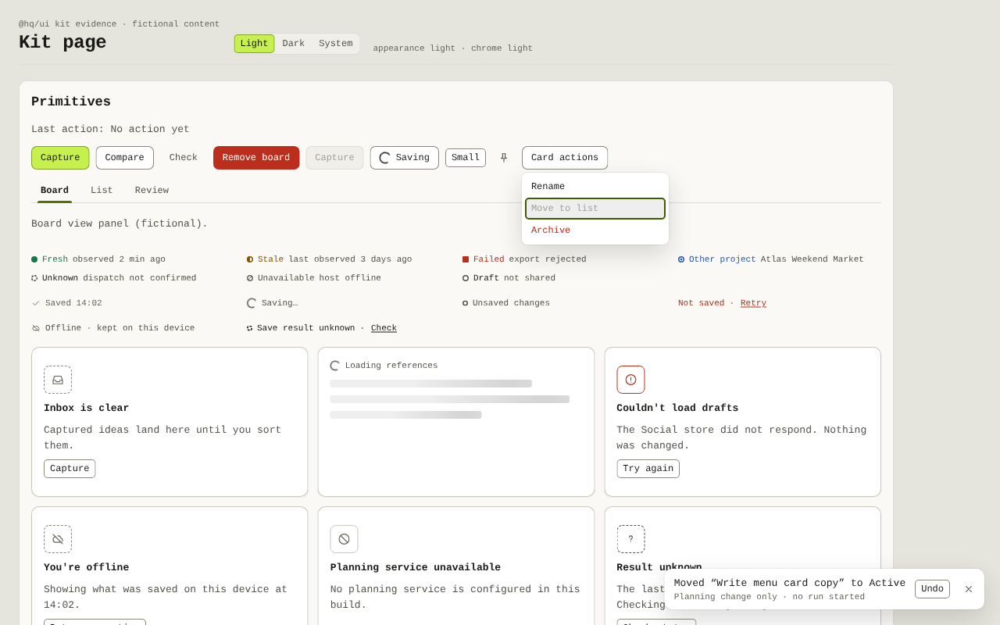
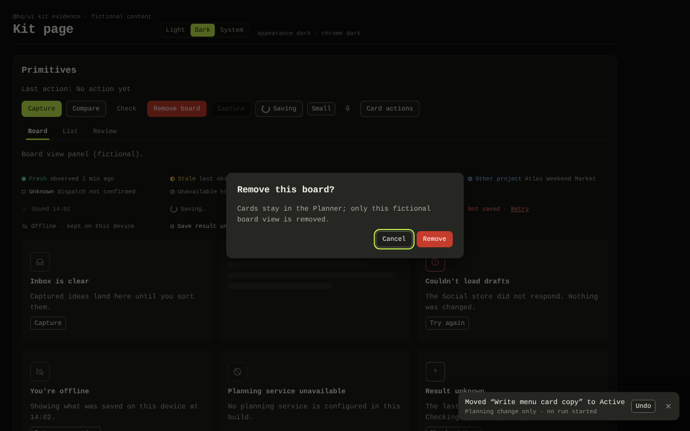

# UI kit evidence (`task.ui-kit.001`)

Authority effect: none. This is the evidence for `spec.hq-social-work#ac.ui-kit.001`, owned by the UI lane. It is local evidence observed on 2026-10-20 on Linux. It is not CI, Electron or macOS evidence.

**Source.** `packages/hq-ui` on `work/hq-ui-kit`, based on R1 `cfdab378`. Tokens are byte-for-byte copies from T2 `f3c1daff9c6ab98d51a1bfb4aafbe83c351c1124`.

## Acceptance at a glance

| `ac.ui-kit.001` item | Result | Where |
| --- | --- | --- |
| The kit consumes T2's tokens at `f3c1daff`; integrity test passes | Pass: size, SHA-256 and Git blob ID match for `hq-tokens.css`, `hq-tokens.json`, `t0-bridge.css` and the contrast-report fixture | `packages/hq-ui/test/tokens.test.ts` |
| All 104 contrast pairs recomputed against T2 thresholds | Pass: 104/104; text ≥4.5, focus/indicator/control edges ≥3; each within 0.005 of T2's report | `packages/hq-ui/test/contrast.test.ts` |
| Token and primitive tests pass in light and dark | Pass: every primitive is rendered under `data-theme="light"` and `"dark"`. These are happy-dom checks of roles, names and keyboard paths, not colour or pixel checks | `packages/hq-ui/test/components.test.tsx` |
| Each `PreservedContent` kind keeps pixels and computed colours across Light, Dark and System | Pass: 8 wells pixel-identical across all modes in two browsers (below) | [Preserved content](#preserved-content) |
| Computed `color-scheme` equals the recorded scheme for ``, SVG-as-`` and a same-origin `srcdoc` iframe probe | Pass with native colour preference. See [the emulation caveat](#cdp-emulation-caveat) | [Preserved content](#preserved-content) |
| No filter, blend or opacity on the well | Pass: computed `filter: none`, `mix-blend-mode: normal`, `opacity: 1` on every well, its content and every ancestor | Probe output below |
| Every primitive operable by keyboard alone | Pass: happy-dom paths for all nine primitives, plus real-browser paths for Button, Menu, Dialog, Tabs and Toast/Undo | [Keyboard](#keyboard-in-a-real-browser) |
| Light and dark evidence of the kit page attached | Attached | [Captures](#captures) |
| T2's unverified surfaces stay listed as gaps | Listed | [Gaps](#gaps-not-passes) |

## Kit page

`packages/hq-ui/test/kit/` is a small Vite page under the **exact CSP of `apps/desktop/index.html`** (`style-src 'self'`, `frame-src 'none'`, …). It has:

- **Wells.** One for each kind × recorded scheme:
  - `captured`: a raster `` drawn from plain rectangles;
  - `producer`: a same-origin `srcdoc` iframe whose `'self'` stylesheet has a `prefers-color-scheme` rule;
  - `export`: an SVG-as-`` with a `prefers-color-scheme` rule, also shown with the checker matte.
- **Controls.** Two unpinned probes in plain chrome. They prove the probes are sensitive.
- **Primitives.** The full primitive set.
- **Appearance.** A Light/Dark/System switch that writes `<html data-theme>` the way T0 does.

`window.hqKit.probe()` reports each element's computed scheme, alteration properties and frame media query. `?probe` writes the same results into the DOM for a headless browser. All content is fictional.

Reproduce from the repository root:

```sh
npx vite build --config packages/hq-ui/test/kit/vite.config.ts      # writes the ignored test/kit/dist/
npx vite preview --config packages/hq-ui/test/kit/vite.config.ts    # serves http://127.0.0.1:4183/
# ?theme=light|dark|system  &only=wells|primitives  &probe
cd docs/evidence/hq-social-work/ui
node ../../../../packages/hq-ui/test/kit/compare-wells.mjs well-rects.json light=captures/<a>.png dark=captures/<b>.png ...
```

`compare-wells.mjs` uses the Node standard library only. It hashes each well's RGB pixels, skipping the four 5×5 rounded-corner squares where clipped chrome shows through. It exits non-zero if any well differs between captures.

## Preserved content

Two browsers were used:

- **App preview:** the Jones Code preview browser, Chrome 154.0.0.0, Incognito profile, 1280×800 viewport, loopback only.
- **Headless Chromium 155.0.8059.79:** T2's engine, driven from the command line with no automation protocol.

**Computed scheme and frame probe.** Pinned frames keep their recorded scheme and the unpinned control follows the chrome. The table rows are chrome appearance and OS preference.

| Browser | Chrome · OS | Frame recorded light | Frame recorded dark | Unpinned frame | All 8 wells: well and child `color-scheme` = recorded | Alteration anywhere |
| --- | --- | --- | --- | --- | --- | --- |
| Preview 154 | Light · light | light | dark | light | yes | none |
| Preview 154 | Dark · light | light | dark | dark | yes | none |
| Preview 154 | System · light | light | dark | light | yes | none |
| Chromium 155 | Light · light | light | dark | light | yes | none |
| Chromium 155 | Dark · light | light | dark | dark | yes | none |
| Chromium 155 | System · light | light | dark | light | yes | none |
| Chromium 155 | Light · **dark** (`--force-dark-mode`) | light | dark | light | yes | none |
| Chromium 155 | Dark · **dark** | light | dark | dark | yes | none |
| Chromium 155 | System · **dark** | light | dark | dark | yes | none |

In the preview, these values held through live switches Light → Dark → System → Dark → Light without a reload. The matte computes `rgb(140, 140, 140)` (`--hq-artwork-matte`), or `rgb(189, 189, 189)` with the checker, in every mode.

**Pixels.** [`well-rects.json`](well-rects.json) gives the regions.

- **Preview 154:** Light, Dark and System (OS light). All 8 wells are identical. Both controls differ between Light and Dark.
- **Chromium 155:** Light, Dark, System (OS light), System (OS dark) and Light (OS dark). All 8 wells are identical; the result is in [`chromium155-well-comparison.json`](chromium155-well-comparison.json). Both controls follow the chrome. Each well's digest also equals its digest in the Preview 154 captures.

### CDP emulation caveat

The preview's `prefers-color-scheme` emulation is CDP `Emulation.setEmulatedMedia`. It overrides the media query in **every** frame, regardless of the owner element's `color-scheme`. Under emulated OS dark, the light-recorded `srcdoc` frame therefore reported dark and its pixels changed ([capture](captures/preview-wells-system-emulated-dark.png)), while the `` and SVG-as-`` wells stayed identical.

With the emulation cleared, the preview browser followed the owner element. The native OS-dark run in Chromium 155 holds in all six chrome × OS combinations. So the failure is an artifact of the test method, not of the pin.

**Consequence for evidence owners:** prove `srcdoc` and iframe pinning with a native preference, never with CDP emulation. The same probe also showed that the app CSP's `frame-src 'none'` **does not block** `srcdoc` frames, which load and apply `'self'` stylesheets. This is relevant to Design's preview wells.

## Keyboard in a real browser

These paths were checked in Preview 154 with real key presses only. Focus rings computed `2px solid` `--hq-focus`: `#3F5A00` in light and `#C6F04D` in dark.

- **Button.** Tab order runs through all buttons. The disabled button is skipped. The busy button stays focusable and inert.
- **Menu.** Enter on the trigger opens it with focus on the first item, without a double toggle from the native click. ArrowDown reaches the disabled item, which keeps a visible inset ring. Escape closes the menu and returns focus to the trigger ([light capture](captures/preview-primitives-light-menu-keyboard.png)).
- **Dialog.** Enter opens it with focus on Cancel. Tab cycles Cancel → Remove → Cancel. Escape closes it, returns focus to "Remove board" and runs no action ([dark capture](captures/preview-primitives-dark-dialog-keyboard.png)).
- **Tabs.** ArrowRight and End move focus and selection. Exactly one tab stop remains (`tabIndex` `[-1, -1, 0]`).
- **Toast.** Tab reaches Undo, and Enter runs only the Undo handler ([dark capture](captures/preview-primitives-dark-undo-keyboard.png)).

The happy-dom tests cover the same paths for all nine primitives in both schemes. A mutation check removed the Dialog Tab trap and made Menu Escape skip the focus return; both were caught (4 failures), then reverted.

## Captures

All captures are fictional content at 1280×800. The Preview 154 tab reported `devicePixelRatio` 2, but its captures are 1×, so this is **not** 2× evidence.

| File | SHA-256 |
| --- | --- |
| `captures/preview-wells-light.png` | `c3a78225d7fdca3d956c6b01fb8007f9603fe5d0368468e77d8ae69fa9695635` |
| `captures/preview-wells-dark.png` | `b72f9cafcb98505c85c50f5f043c2d3752dcd02eb701903c169fa15489269251` |
| `captures/preview-wells-system-os-light.png` | `5a9d55d4b3dbbd976a96b18dbb079a97fc471a594b05cd48739a4dab66cae168` |
| `captures/preview-wells-system-emulated-dark.png` | `d844b9b266ef41529ad3807d9dd53dc634dfaa37caf93c8d9fd2b5e1f0da0881` |
| `captures/preview-primitives-light-menu-keyboard.png` | `2be8a3b0862f5762c15cebdb678fea620f8f15e8d38b667b588ac37c1d742bc5` |
| `captures/preview-primitives-dark-dialog-keyboard.png` | `2e1bacd2723b4945254bd57f673933f685c1fd464a8e137f9d07d0ca1699bfb5` |
| `captures/preview-primitives-dark-undo-keyboard.png` | `e3a99f70921c51f184322bf8ea0248e2f1a541efaad88ec9feeb3f9ec64c4b57` |
| `captures/chromium155-wells-light.png` | `70cf57a1172c4c7ebdf9e98ebe7af4ebb1a4584f1d97fe61a9f8e17409f77f1f` |
| `captures/chromium155-wells-light-os-dark.png` | `70cf57a1172c4c7ebdf9e98ebe7af4ebb1a4584f1d97fe61a9f8e17409f77f1f` (byte-identical to Light: the OS preference changes nothing when the chrome is explicit) |
| `captures/chromium155-wells-dark.png` | `769b491dffcbea0f02ea290e9983579e636b3334dd6a9bf843824bf54d13800e` |
| `captures/chromium155-wells-system-os-light.png` | `1df3350cf7eb1c913ddf4dbed5a3f9623ec1a478f4ddd7896f08f008994609fb` |
| `captures/chromium155-wells-system-os-dark.png` | `3b26c0e4abab3fcb41159c7a3e6f791ed48acd8a5158282ef9f883f22430d70f` |





## Build note: `light-dark()` is lowered

Vite 8 minifies CSS with Lightning CSS. For its default targets it rewrites every `light-dark(a, b)` token into `--lightningcss-light` / `--lightningcss-dark` toggles, keyed on the `color-scheme` declarations. `apps/desktop/vite.config.ts` has the same defaults.

**What still works:**

- Whole-document theming through `<html data-theme>` (verified above).
- The well's native `color-scheme: var(--hq-content-scheme, normal)`, which is not rewritten. The RS-2 pin therefore holds in production builds.

**What does not:** the lowered token values resolve at `:root`. A **nested** `[data-theme]` subtree (for example a side-by-side specimen sheet) will not re-theme token colours in a Vite build, though it does natively. This is recorded as deferred finding F1.

## Deferred findings

These are self-review findings, not independent review. They are recorded and not implemented: P2–P4 items wait for owner direction.

| ID | Severity | Finding | Owner / proposal |
| --- | --- | --- | --- |
| F1 | P3 | Vite's Lightning CSS lowering of `light-dark()` breaks token re-theming inside nested `[data-theme]` subtrees in production builds. Document-level theming is unaffected. | Root/shell. Either set `build.cssTarget` in `apps/desktop/vite.config.ts` to the Electron Chromium version so `light-dark()` ships natively, or document that only document-level theming is supported. |
| F2 | P3 | CDP `prefers-color-scheme` emulation overrides every frame, so emulated evidence for iframe or `srcdoc` wells is invalid. | Design owners of preview, compare and export wells (issue #1). Use a native preference, as in the Chromium 155 runs here. |
| F3 | P3 | `Dialog` traps focus and sets `aria-modal`, but does not make the background `inert`, because the kit does not own the app root. A screen reader's virtual cursor may still reach the background. | UI with shell chrome: have the shell set `inert` on its root while a modal is open, or move to native `<dialog>.showModal()` once Electron is verified. |
| F4 | P3 | The toast region is fixed bottom-right and reached by Tab in DOM order; there is no shortcut to jump to Undo. | Consumers and the shell, for example an F6-style region shortcut. |
| F5 | P3 | `StatusChip` throws on an empty label. This deliberately enforces "never colour alone", but a data bug would crash the owning view. | UI. Keep it, or downgrade to a development warning, at the owner's direction. |
| F6 | P4 | HQ's danger-button hover uses a `--hq-surface-hover` overlay instead of T2's `filter: brightness(1.08)`, so no control relies on `filter`. White on the hovered fill is 4.82:1 dark and 6.39:1 light. | T2 reference geometry owner, for awareness only. |
| F7 | P4 | The kit page's own Light/Dark/System switch is a set of buttons with `role="radio"` but no arrow-key handling. This is a test page only; the real titlebar control belongs to `task.shell-chrome.001`. | UI, with shell chrome. |

## Gaps (not passes)

- **Electron.** Not run; the Electron binary is not even downloaded in this checkout.
- **macOS and SF Pro fallback.** Not available on this Linux host.
- **Real window controls.** Not available on this Linux host.
- **Screen readers.** Not run. Roles and names are asserted, but nothing was announced by a real assistive technology.
- **Forced colours.** Rules exist in `hq-ui.css` but are unverified in a forced-colours mode.
- **2× capture.** Not done; see the capture note above.
- **Reduced motion.** Verified only statically (CSS test). It was not rendered with the preference on.
- **IBM Plex.** No font files ship. The preview host renders the system fallback face, so type differs from T2's Plex mockups until the OFL provenance gate clears.
- **Contrast.** Contrast figures are WCAG 2.x calculations, not perceptual tests.
