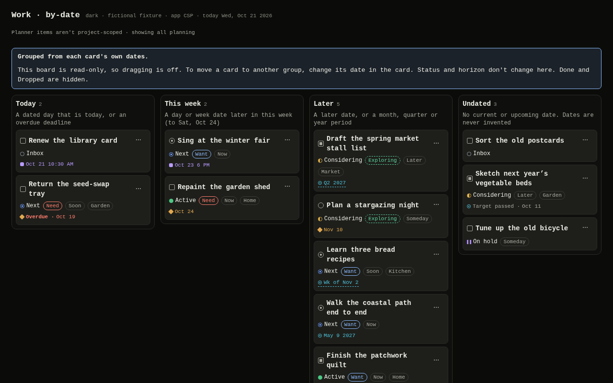
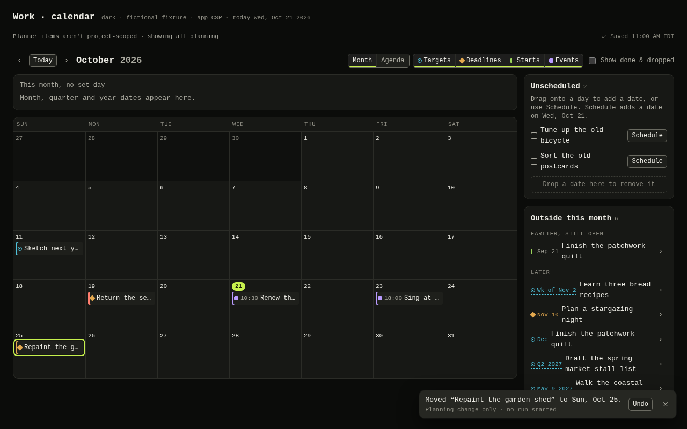
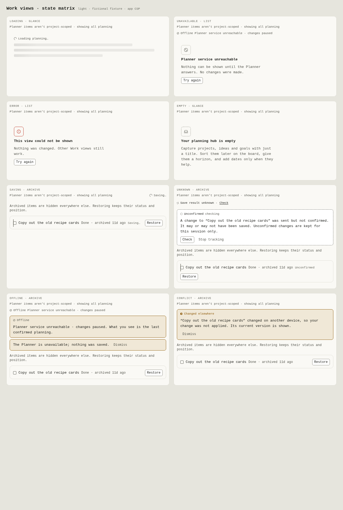

# WRK-P evidence: Work core and planning views

Authority effect: none. This is lane-local continuity and evidence for `spec.hq-social-work#ac.work-core.001` (`task.work-core.001`, below) and `spec.hq-social-work#ac.work-views.001` ([views](#views-taskwork-views001)). Checks listed here are local runs, not CI.

## Lane binding

| Item | Value |
| --- | --- |
| Lane | WRK-P (Work planner), Claude Opus 5.5 at high effort, no descendants, no model or provider switch |
| Model-selection mode | `claude_frontier` from `explicit_workstream` (read-only `status`, preference revision 1; nothing written) |
| Repository and branch | `Jones-Systems/HQ`, `work/hq-work-planner`, its own linked worktree |
| Base | R1 `cfdab378e28940662ddb6e731264afca164a1957`; accepted foundation `35f9a3e` is an ancestor |
| Parent PR | #3 (`work/hq-social-work-plan`), head `d5a34d74b3474fa8d259c4230e58f7f50ee505a5`, which adds only R0/R1 evidence and work-note lines on top of R1 |
| Plan | `docs/engineering-specs/hq-social-work.md` at R1, read through the section reader |
| Released scope | Core: `modules/work/core/**` and this directory. Views: `modules/work/views/**` and this directory; core is accepted and read-only |

## Guidance read at startup

- **Codex V3 root `AGENTS.md`.** Read in full (445 lines). Commit `4beb491c44551b6e4207adcc7459c4b11407bcbc`, blob `3402719bc3a09e7e08ed113425d7137818eda25c`, 30,716 bytes, SHA-256 `1238a90adbf10ea8f2359f90ed0c7bf99fc1121589dcde5b99881fd247e87ce6`. All four identities were rechecked against the checkout.
- **Guides loaded on trigger:** temporary test and scratch practice; the model-selection precedence section; the CPU telemetry skill; the section reader skill; the `codex-v3-builder` profile text, carried in the prompt only. The profile's isolation is not enforced by the native launcher, so none is claimed.
- **HQ.** `AGENTS.md`, `CLAUDE.md`, `docs/engineering-specs/hq-bootstrap.md` and `docs/design/hq-shared-foundation.md`. There are no nested `AGENTS.md` files on the touched paths.
- **Shared enrollment.** `.agents/shared-guidance.md` is absent on this baseline, so shared enrollment is **unavailable**. Nothing was installed.
- **Plan sections read at R1:** `task.work-core.001`, `iface.work-port.001`, `req.work-core.001`, `req.safety.001`, `ctx.d1-import.001`, `ctx.work-design-binding.001`, `ac.work-core.001`, `test.work-core.001`, `ctx.launch-preflight.001`, `ctx.change-surface.001`, `ctx.stop-recovery-delivery.001`, `iface.references.001`, `iface.service-reference-extensions.001`, `iface.domain-module.001`, `req.work-views.001`, `req.references.001`, `ctx.check-catalog.001`, `ctx.test-plan.001`, `ctx.lane-capsules.001`.
- **Other inputs.** The R0/R1 evidence blobs at `d5a34d7` (`a8b68053…`, `998f540c…`). T4's `docs/design/work/` at `1bb550de4069ff6b0e1666844896b1a6c2cb03e9`. T4 is design input only; its mocked statuses are not service proof.

**Conflicts, and how they were resolved:**

1. V3's default is to delegate to sub-agents. The explicit owner rule of no descendants governs, so all work was done in this one thread.
2. V3's default delivery includes merge. The merge hold governs: this lane publishes one PR and does not merge.
3. The task's literal `write_scope` is `modules/work/core`. The launch also releases `docs/evidence/hq-social-work/work-planner/**`, and the writer map assigns it to WRK-P. Both paths are used.

## D-1 import binding

The bytes were bound independently before the copy, from the Codex V3 checkout at `4beb491c…`. Each Git blob, SHA-256, size and last-change commit `41503af8f1d143de54063ee70effb00ffdd399b1` was checked, along with the MIT `LICENSE` and the source's own `provenance.json`. All of them match `ctx.d1-import.001`.

The files were copied with `git cat-file blob`. `git hash-object` on the copies reproduces the source blob IDs. No other private file was copied. Interface research read these Git objects only: `planning/validation.py`, `planning/dates.py`, `planning/store.py` and `planning/server.py`. No data, SQLite store, backup or live instance was opened.

## What the core provides

All paths are under `modules/work/core/`. Consumers import from `index.ts`.

| File | Contents |
| --- | --- |
| `types.ts` | RW-1 item model and enums; `Settings`; `NewItemFields`; `ItemPatch` (no `status`, enforced at the type level); `ItemReference` with the `hq` variant; `HQ_REFERENCES_FEATURE`; `LIMITS` |
| `port.ts` | `PlannerPort`, `Snapshot` (with `features`), `WriteResult`, `Anchor`, `PlannerError`, `PlannerPortError`, `PLANNER_PORT_KEYS`, `plannerErrorOf`, `isRequestId`, `newRequestId`. There are no execution, export, import or backup members. |
| `validation.ts` | A hand-written mirror of the Planner's validation, with the service's messages and field names: `normalizeFields`, `normalizeSettings`, `isSafeUrl`, `isValidTimezone`, `wallTimeToInstant` (DST gap → null; an ambiguous time resolves to its first occurrence), `checkPeriod`, `stripDerived` |
| `planning.ts` | Wrappers over the upstream logic, plus re-exports: `plannerToday` (the zone comes from settings), `weekBounds`/`plannerMonthGrid` (honor `week_start`), `reviewBucketsFor`, `statusOrder`, `restoreAnchor`, By date `byDateGroup`/`groupByDate`/`BY_DATE_GROUPS`, and the filters |
| `store.ts` | `createWorkStore(port)` and `sharedWorkStore(key, create)`. Details follow this table. |
| `hook.ts` | `useWorkState(store, { pollMs })`. It loads on first use and polls the version while the document is visible. Unmounting stops polling and keeps all state. |
| `fixtures/adapter.ts` | `createFixturePlanner()` returns `{ port, control }`, an in-memory stand-in for the service. Details follow this table. |
| `fixtures/faults.ts` | `withFaults(port)`: lost response, drop, deferred delivery and `unavailable`, for tests and previews |
| `fixtures/examples.ts` | Fictional example items, dated relative to a given day |
| `upstream/manual-planner/` | The three verbatim copies, hand-written `.d.ts` siblings and `PROVENANCE.md` |

**`store.ts`.** The store is module-level, so it survives T0's remount on a domain switch. It provides:

- optimistic projection with rollback;
- per-item serialized writes;
- save states (`saveLabel`: Saving… / Saved · time / N unconfirmed / Offline · not saving);
- conflicts, notices and an in-session unconfirmed queue;
- a 40-entry undo stack whose entries are consumed once.

Status changes go through `move` only. Undo of a field patch is compare-and-swap; it re-checks once against the current item after a stale-revision conflict. Undo of a move restores the exact neighbor anchor, and undo of a create archives the item.

**`fixtures/adapter.ts`.** It mirrors `store.py` at the D-1 commit:

- revision guard, `revision_conflict` (with the current item), `order_conflict`;
- top-of-status create, and target-only renumbering without neighbor revision bumps;
- no-op moves and archives;
- a `state_version` increment on every successful mutation;
- history;
- **actual replay** (`replayed: true`) and `request_id_reused`, with a 2,000-ID FIFO record. Failed calls record nothing.

Derived `instant`, `end_instant` and `tz_abbr` are added on read. The `hq` reference variant is accepted only when the fixture's `features` include `hq-references-v1`.

**Reconciliation (RW-9) as built:**

- An `unknown` write stays unconfirmed, with its projection kept and marked. It is resolved only by re-sending the stored request ID and body:
  - a replay confirms it;
  - a first apply confirms it;
  - a conflict is removed from the queue and shown as "may or may not include your change";
  - `request_id_reused` holds the whole queue until the entry is dismissed.
- `patch`, `move`, archive and review carry a revision, so they are re-sent automatically on poll.
- `create` and `updateSettings` carry no revision. They are re-sent automatically only while the replay record is provably kept: the fresh `version()` minus the base version is below 2,000. Past that point the entry becomes `awaiting_decision`, and only an explicit `retryUnconfirmed` re-sends it.
- Snapshot contents never resolve an entry. A same-title item created since the attempt is listed in `possiblySavedIds` as a flag only.

## Checks (local, this worktree, 2026-10-20)

Telemetry admission was taken before each test or build command. The samples read 8.75% to 19.94% CPU used, 40.06 to 43.62 GiB available, and a serial ceiling of 1.

The first `npm ci` in this fresh worktree added 149 packages from the unchanged lockfile. The dependency, lockfile and root configuration are untouched.

| Command | Result |
| --- | --- |
| `npx vitest run modules/work --no-file-parallelism` (the projected `work-module` group: `modules/work/**/*.test.ts(x)`) | 7 files, 194 tests pass |
| `npx vitest run --no-file-parallelism` (full discovery) | 12 files, 222 tests pass |
| `npm run typecheck` | Pass |
| `npm run build` | Pass. Output went only to the ignored `apps/desktop/dist/` and `dist-electron/` directories. Removing them was blocked by the host's destructive-command guard, so they remain, ignored and uncommitted. |
| `tsc --ignoreConfig --strict --skipLibCheck false … upstream/manual-planner/*.d.ts` | Pass. Root `skipLibCheck` skips `.d.ts` bodies, so the declarations were checked separately. |

One earlier `npm test` used Vitest's default parallel file workers; it also passed (222 tests). Every other run, including the final ones above, was serial.

The test files are `upstream-integrity.test.ts`, `validation.test.ts` (with `parity-cases.ts`), `planning.test.ts`, `conformance.test.ts`, `store.test.ts` and `hook.test.tsx`, all under `modules/work/core/test/`.

**Acceptance mapping (`ac.work-core.001`):**

| Requirement | Where it is tested |
| --- | --- |
| Parity for every enum and limit, each date precision, time/zone and DST-gap rule, and the URL rule | `validation.test.ts`: 100 field cases and 8 settings cases |
| Ordering, `week_start` periods, review buckets and filters | `planning.test.ts` |
| T4 conformance cases 1–6 | `conformance.test.ts`. Case 4 is a `@ts-expect-error` that `tsc` verifies. |
| T4 conformance case 7, By date at fixed dates under both `week_start` values | `planning.test.ts` |
| Same-request reconciliation, possibly-saved flag, exact undo anchors, consume-once undo and CAS undo | `store.test.ts` |
| Remount survival | `hook.test.tsx` |

**Planner-rule oracle.** The test intent says expectations must not be derived from the TypeScript. Every parity expectation was written from the Python rules. They were then run through the Planner's own `normalize_fields` and `normalize_settings`, executed in memory from the Git objects at `4beb491c…` with the deterministic id generator. Nothing private was written to disk. Result: **108 cases, 0 mismatches**, on the host's Python 3.13.5.

The proposed `hq` cases have no service implementation and cannot be checked this way; they are labeled proposed-schema behavior.

**Mutation checks**, each restored afterwards. Each mutation was caught by the intended test:

- removing the replay-window guard;
- removing the CAS refusal;
- reporting replays as `replayed: false`;
- disabling the possibly-saved flag.

## Known gaps for core (not claimed)

- **Time zone membership is host-dependent.** HQ accepts a case-exact IANA name known to the runtime's ICU database. The service checks its own host's zoneinfo, which differs at the edges: this host's Python lacks some backward aliases and accepts `Factory`/`localtime`. The service stays authoritative.
- **Python-only edge forms are not mirrored.** The client is stricter on Unicode digits in date values and on bracketed-host validation. It treats `[]`/`{}` as empty where the service's `or` default does.
- **`tz_abbr` from the fixture uses ICU short names.** For example, `GMT+1` appears where Python says `CET`. This is display-only fixture data.
- **`WriteResult.changed` is the item list the port contract defines.** A live adapter must derive it, for example by reading back the snapshot, because the service returns field names.
- **Out of scope here:** RW-10 HQ device drafts (owned by capture), the live adapter and bridge (D-2 is unapproved), views, D-3 lists and boards, and persistence across restart (G-3). The unconfirmed queue says it is session-only (`UNCONFIRMED_SCOPE_NOTE`).
- **No CI** is configured on this base. Native Electron and the installed app are unverified. There is no independent review; self-review only.
- **The affected-check claim is a projection.** `tests/check-groups.toml` is Design-owned, and the proposed `work-module` group is not integrated. The literal globs above were run instead.

## Deferred findings for core (recorded, not implemented)

- **P3.** The move-undo compare-and-swap checks status only. A same-status reorder by another device is overwritten by the restore anchor; the revision guard catches only a stale local view.
- **P3.** The projected `archived_at`/`reviewed_at` for an in-flight write takes a fresh timestamp on each recompute. It is display-only and replaced on confirmation.
- **P4.** `sharedWorkStore` entries live for the session, with no disposal. This is intended for one Work session per window.

## Views (`task.work-views.001`)

Root released this task after accepting core at `a8c791a877bd28974894e1d48913d0ff460b6f00` (PR #26). The lane binding above is unchanged: the same model, effort, worktree and branch, with no descendants. Core is consumed through `modules/work/core/index.ts` only and was not edited.

### Dependency: the accepted UI kit

- **Merge.** Root accepted `task.ui-kit.001` at `935dedf78e04a2697bdc02d85864546948ffcb8c` (PR #24: source `1b7dcae`, evidence `935dedf`). It was consumed by one normal merge into this clean worktree: `c78eecf66ac63fdee4d209995f3fc4873b972258`, with parents `a8c791a` and `935dedf`. The merge had no conflicts.
- **Unchanged kit files.** The merge touched only `packages/hq-ui/**` and `docs/evidence/hq-social-work/ui/**`, and `git diff 935dedf HEAD` over those paths is empty. No kit, manifest, lockfile, root config, contract, App, style, Design, IPC or catalog file was edited.
- **Read before use.** The kit `README.md` and its evidence were read first. The views rely on document-level theming through `<html data-theme>`, which is supported. A nested `[data-theme]` subtree does not re-theme in Vite builds; that is the kit's deferred finding F1, inherited unchanged. The views render no preserved content, so the CSSOM pin is not exercised here.

### Inputs read

- **Guidance.** Re-checked V3 `AGENTS.md`: its SHA-256 `1238a90a…` is unchanged. Re-read HQ `AGENTS.md`.
- **Plan sections at R1.** `task.work-views.001`, `req.work-views.001`, `ac.work-views.001`, `test.work-views.001`, `iface.ui-kit.001` and `ctx.visual-system-binding.001`.
- **T4 design.** The "Information architecture", "Movement and undo", "Today, This week, Later", "Other views", "Appearance", "Narrow layout", "States" and "Acceptance checks" sections of `docs/design/work/hq-work-design.md` at `1bb550de…`. Also the mockup's By date banner wording and `--work-*` role values.
- **Planner interface research.** Git objects only, at `4beb491c…`:
  - `public/js/views/{calendar,timeline,glance,review,list,archive,common}.js`;
  - `changeDate`, `stripDerived`, `patchItem` and `moveItem` in `public/js/actions.js`.

  Nothing was copied, and no data, store or live instance was opened.

### What the views provide

All paths are under `modules/work/views/`. The Work domain mounts `PlanningViews` from `index.ts`.

| File | Contents |
| --- | --- |
| `PlanningViews.tsx` | The host, `PlanningViews({ store, view, filters?, now?, pollMs?, openItem?, editDate?, capture?, navigate? })`. It renders the not-project-scoped note, the save state, the banners (offline, held, unconfirmed with Check / Re-send same request / Stop tracking, conflicts, notices), the loading and unavailable states, an error boundary, and the Undo toast (`NO_RUN_NOTE`). Ctrl/⌘+Z is handled on its root. |
| `Glance.tsx`, `ListView.tsx`, `Calendar.tsx`, `Timeline.tsx`, `Review.tsx`, `Archive.tsx`, `ByDate.tsx` | One view each |
| `moves.ts` | The pure Planner behaviour: the date patches (`shiftDatePatch`, `rescheduleDatePatch`, `removeDatePatch`, `addDatePatch`), `scheduleDay`, timeline lanes, steps and geometry, Glance and Calendar selections, `untouchedDays` |
| `parts.tsx`, `env.tsx`, `meta.ts` | Chips, rows and section heads; the view environment and remembered view preferences; navigation metadata (`WORK_VIEWS`, `WORK_BOARDS`, `WORK_HOME_VIEW = 'board'`, `PROJECT_NOTE`) |
| `work-views.css` | Module-local roles and `.wv-*` styles. There are no inline styles; positions are set as `--wv-*` properties through CSSOM. |
| `fixtures.ts` | Fictional items that extend the core examples so every view and Review bucket has content |
| `evidence/` | A Vite page under the exact app CSP for the light and dark captures; its build output goes to the ignored `evidence/dist/` |

The links `openItem`, `editDate`, `capture` and `navigate` connect to the detail, capture and domain lanes. Each one only navigates or opens UI. A control that needs a link is hidden while that link is absent.

### Behaviour and parity with the Planner

- **Calendar.**
  - **Layouts.** Month (honouring `week_start`) and Agenda; kind toggles; "Show done & dropped".
  - **Period bands.** "This month, no set day" for month, quarter and year dates. A month date is never placed on a day. A week band per row.
  - **Unscheduled tray and Outside this month.** "Earlier, still open" (open, non-event, ended, up to 6) and "Later" (up to 8).
  - **Moving a day date.** By menu (one day earlier, one day later, one week later, Remove this date), by Alt+← / → / ↑ / ↓ (−1 / +1 / −7 / +7, following into another month and keeping focus), or by dragging to a day or onto the tray.
  - **The patch.** Each move is one `dates` patch, in the Planner's `changeDate` form. The full list is sent in write form with only the moved entry's `value` changed. Kind, time, end time, zone and note are kept, and derived instants are stripped. Undo is offered.
- **Timeline.** Eight quarters from today's, and the lanes Now, Soon, Later, Someday and No horizon. A row moves by drag, by Alt+↑ / ↓ to the adjacent lane, or by its menu (M). Each move is one `{ horizon }` patch with Undo. A bar is drawn only from a start date to the next later end; nothing gets an invented duration. Out-of-range dates show as edge labels.
- **Glance.** The greeting by the display-zone hour, the summary, and the status strip (navigation only). Panels: Now (up to 8), Next 21 days (overdue first, then by day, then current month and quarter periods), Inbox (up to 6), Worth a look and Recently changed.
- **List.** Nine sortable columns. Inline Status is a `move` to the top of the new status, so its Undo restores the place. Inline Horizon is a patch.
- **Review.** "Gentle prompts. Nothing changes until you choose an action." Sections:
  - Sort the Inbox: Why and Horizon toggles, Move to…;
  - Overdue deadlines: Reschedule, Mark done;
  - Targets that have passed: New target;
  - Active but quiet: Still active, Move to…, and the Quiet after (`stale_days`) preference, saved on Enter or blur;
  - Horizon and date disagree;
  - No "why" yet.
- **Archive.** Restore, with Undo. Nothing is deleted.
- **By date (RV-5).** Groups come from `groupByDate`, at core, using only each item's own dates:
  - **Today:** a day date today, or an overdue deadline.
  - **This week:** a day or week date to the end of the `week_start` week.
  - **Later:** any later date or period.
  - **Undated:** everything else.

  Each group shows its rule, with the week's end date. Done, Dropped and archived items are hidden. Cards show the Planner horizon as the Planner labels it; no horizon is ever mapped to a group. The T4 banner is shown.

  **What "never writes" means here.** The board writes nothing from placement:
  - cards are not draggable, and drop targets accept nothing;
  - Alt+arrow moves are inert and announce *"By date is read-only. To move a card to another group, change its date in the card."*

  The move menu offers the seven statuses only, with no reorder items. Choosing one is the single explicit write: a `move` to the top of that status. It never writes a date or a horizon. Groups never write.
- **Project note and areas.** *"Planner items aren't project-scoped · showing all planning"* is shown in every view and state. `PlanningViews` has no project input. `area` is shown as a label, and it filters only through the board-level filters, never as a project.

**Deliberate differences from the Planner client:**

- **"+N more" on a busy day** expands the day in place, where the Planner opens a list menu.
- **Scheduling from the tray asks which date kind to create**, as RV-4 requires: through a menu from Schedule, and through a dialog for a drop. The Planner opens its date editor, or a menu at the drop point.
- **Date-editor actions need the detail lane.** "Edit date…", Review's Reschedule and New target open the detail lane's date editor through `editDate`. They are hidden when that link is absent.
- **No Glance example loader.** The Planner offers "Load example items", but the port has no import member. "New item" appears only when the capture link is present.
- **View preferences stay in memory.** Calendar month, layout, kinds, finished items and List sort are kept in memory for the session, not in `localStorage`. They survive a domain switch. No shell storage member exists yet (G-3).
- **Toasts never dismiss themselves**, by the kit's rule. A toast's Undo disappears once its entry has been consumed elsewhere, so a stale Undo can never replay.
- **Offline wording.** Offline says *"Planner service unreachable · changes paused"*. The kit's offline save wording promises a device copy, which Work does not keep, so it is not used.

### Module-local roles

The roles are `--work-st-<status>` and `--work-dk-<datekind>`, with T4's mockup values in light and dark. Each is paired with a word and a distinct shape:

- **Status shapes:** ring, half, dot, filled, pause bars, square, slashed.
- **Date-kind shapes:** ringed dot, diamond, start bar, square.

`moves.test.ts` checks every role in both modes against `surface`, `surface-raised` and `surface-sunken` from the kit's token source:

- status roles are shapes, so they need 3:1;
- date-kind roles colour text, so they need 4.5:1.

One value deviates from the mockup. The light Dropped role was `#979BA3`, which measures 2.65:1 on `surface`. It is now `#80848C`, which passes 3:1 on every surface. Forced-colours and reduced-motion rules exist but are verified only statically.

### Checks (local, this worktree, 2026-10-20)

Telemetry admission was taken before each test or build command. The samples read 7.26% to 14.92% CPU used, 44.25 to 45.99 GiB available, and a serial ceiling of 1. One early module typecheck ran before that run's telemetry sample was taken; it was light and passed. Every test run was serial (`--no-file-parallelism`).

| Command | Result |
| --- | --- |
| `npx vitest run modules/work --no-file-parallelism` (the projected `work-module` group) | 11 files, 278 tests pass, including 84 view tests in 4 files |
| `npx vitest run --no-file-parallelism` (full discovery) | 21 files, 352 tests pass |
| `npm run build` (runs `npm run typecheck` first) | Pass. The app does not mount the views yet; mounting belongs to the domain lane. The views are type-checked through `modules/work`. |
| `npx vite build --config modules/work/views/evidence/vite.config.ts` | Pass. Output went only to the ignored `evidence/dist/` |

The view tests are all under `modules/work/views/test/`:

- `calendar-timeline.test.tsx`: the documented patches, Undo, the menus, keyboard, drag, the precision band, Outside this month, `week_start`, and remount memory.
- `by-date.test.tsx`: classification, `week_start` (Sunday the 25th is Later in a Sunday-start week and This week in a Monday-start week), Undated, no horizon relabelling, inert drag and keyboard with zero writes, and status-only menus.
- `views.test.tsx`:
  - every view renders the fixture with the project note, in light and dark;
  - the state matrix in both schemes: loading, unavailable, error, empty, saving then saved, unknown (unconfirmed, with Check), offline and conflict;
  - List, Glance, Review and Archive actions;
  - Ctrl+Z and stale-Undo removal;
  - zero execution: every view, layout toggle, sort and link produces no write, no `fetch` and no `window.open`, and the only port calls are `snapshot`.
- `moves.test.ts`: the pure patches and selections, and role contrast.

**Acceptance mapping (`ac.work-views.001`):**

| Requirement | Where it is shown |
| --- | --- |
| Glance, List, Calendar, Timeline, Review, Archive and By date render the synthetic fixture | `views.test.tsx` (each view, both schemes); captures |
| Calendar and Timeline moves produce the documented patch with Undo | `calendar-timeline.test.tsx`; `moves.test.ts` |
| By date classifies only by actual dates, honours `week_start`, keeps undated items in Undated, and never writes (drag inert, no reorder items) | `by-date.test.tsx` |
| The project note is shown, and nothing filters by `area` as a project | `views.test.tsx` |
| Light and dark evidence is attached | [Captures](#captures) |

**Mutation checks.** Each source file was restored afterwards and verified by SHA-256.

- **First round:** four mutations were tried and only one was caught.
  - **Caught:** By date Alt+arrow writing a status.
  - **Not caught: derived fields left unstripped on the item's other dates.** The fixture item had one date.
  - **Not caught: Alt+↓ on a chip also opening its menu.** The moved chip remounted and hid the menu.
  - **Not caught: a stale toast keeping its Undo.** Ctrl+Z always replaced the toast.
- **Second round:** the three missed tests were strengthened. These now check a second timed date, check that no menu exists before the move lands, and consume the entry through the store directly. All four mutations were caught.

### Captures

The page is `modules/work/views/evidence/`. It renders the fictional fixture with today fixed at Wed, Oct 21 2026 in America/New_York and a Sunday week start. It runs under the exact CSP of `apps/desktop/index.html`, with an in-memory fixture adapter and `connect-src 'none'`. It was served by `vite preview` on loopback port 4184, which was stopped afterwards.

The captures were taken with headless Chromium 155.0.8059.79 from the command line, using `--window-size`, `--virtual-time-budget=4000` and `--screenshot`, with no automation protocol. The theme was set through `<html data-theme>`.

The set has 24 files:

- each view in light and dark at 1280×800;
- the calendar after an Alt+→ move with its Undo toast;
- the state matrix (loading, unavailable, error, empty, saving, unknown, offline, conflict) at 1280×1900;
- Calendar, By date and Timeline at 900×700.

| File | SHA-256 |
| --- | --- |
| `captures/archive-dark.png` | `c3b455c4958cb263a871a47918d7c2e3ec433c4fa8244dfb2a4d38726b25c079` |
| `captures/archive-light.png` | `686ff0cebdbf34bd217a3323ab3e42698b5a6cf24e8f24947a4dbb8cf1960184` |
| `captures/by-date-900-dark.png` | `00a2e985408789e69500a5d8992643bf1122fba80fb2e151dc8299ee238622a9` |
| `captures/by-date-900-light.png` | `c49e3cae18d01e34ccc167fb01bc8e1a32a6be0c58dbcc43f2a93c6e32edbc36` |
| `captures/by-date-dark.png` | `0ab895d8c57e05bdd1750dd9c4e48d88e0fb5c1424bad19c9f0f6ac437b9e4de` |
| `captures/by-date-light.png` | `434825c07085c5abde278f39bcc2d9f0558ae87606df49b43d6a70bd762c3ded` |
| `captures/calendar-900-dark.png` | `53d45e158f58f7c82b7706c0b3bdffca82d878450f4ab2f65e65cc55b82021a1` |
| `captures/calendar-900-light.png` | `bb070ad6c6c664d83e39d91d55f41a4d397828953f6e9e8a34b657142237552f` |
| `captures/calendar-dark.png` | `a772fb495ffbb3953d1797655a32c5337e09e601f46031bc1d50bb4e2172b7bb` |
| `captures/calendar-light.png` | `9d38a377b632488396c5abfbf50aaa065af03a9653b73ab77559042ac91a2263` |
| `captures/calendar-undo-toast-dark.png` | `e961481a2e128c4393908196895c3c64fcb491af412598aec00ca69521f47cc6` |
| `captures/calendar-undo-toast-light.png` | `2e00d4d0a89f362e10af792a9c8dea24d49caa274ba0a80c1cc4356aaad81210` |
| `captures/glance-dark.png` | `425893b8010b92dffe3370a6fec645a112719a98030e77e1d003cf67bec891ca` |
| `captures/glance-light.png` | `536147b69c9aab945ba7049689034878611069b3a08bf25bd492768a98b5b2fa` |
| `captures/list-dark.png` | `a383b6c38fdcd412998fecddd9ed16d3b47b048b4b380215bf6ffd63423a4bd9` |
| `captures/list-light.png` | `abf3b5a4360f5893858d0a3f17fc05c0bd038c0f6ca842249870656277ee250e` |
| `captures/review-dark.png` | `e003b1fa58c9dee50bebca91e0119cdadbe73a3d55a34c28c451a999b3c7cf63` |
| `captures/review-light.png` | `03f249dabd206e75422c8b7b6d9205e219e716c8bbb35c4b0e159478893f6c37` |
| `captures/states-dark.png` | `7e2199783f971e9846242383b30d523a606695f74f58d5260dfb0d56eb349370` |
| `captures/states-light.png` | `0cadcf60e07f89d3cba28583d324ea7f3e29a23a9617c81d4efaccf1044e2c9c` |
| `captures/timeline-900-dark.png` | `4f0c7285395117ef281e0dd7191ccd23633326c86b4ff52969d94298b27fb07d` |
| `captures/timeline-900-light.png` | `164e6e84f9ec5fcdcb888dfc3d2487e22dc713e24d69d9bcaf5d678d2d907664` |
| `captures/timeline-dark.png` | `381311502fdfd713c8e206573cd443617a451025e4a5825587e06269424df1f0` |
| `captures/timeline-light.png` | `1ee9ad8c828d7093849a5bc2ad8480e3eceb2993d27191a1a84c7669d2a952e5` |

**What the captures do not show:**

- They are 1× captures, so this is not 2× evidence.
- Type renders in the host's fallback face, because no IBM Plex files ship.
- They are not Electron, macOS, a screen reader or forced-colours captures.
- Reduced motion was not rendered with the preference on.
- Drag was proved in happy-dom with synthetic drag events, not with a real pointer.

### Known gaps for views (not claimed)

- **Touch drag.** Drag uses HTML5 drag and drop, which has no touch support. Every drag has a menu or keyboard alternative. The 320 ms touch hold and the narrow-layout status tabs belong to the board lane.
- **Restoring state after a domain switch (RV-6).** Restoring view, filters, scroll and selection belongs to the domain lane. These views keep only their own preferences in memory.
- **Mounting.** The views are not mounted in the app yet. Mounting, the view select in the narrow top bar, and Board as home belong to the domain lane; `WORK_HOME_VIEW` records the default.
- **Parity limits.** The ICU/zoneinfo and Python-edge parity limits listed for core still apply. The live service stays authoritative. No universal parity and no live acceptance are claimed; everything here ran on the fictional fixture adapter.
- **Check catalog.** `tests/check-groups.toml` is Design-owned and unchanged. The `work-module` claim is a projection of the literal globs.
- **Review and CI.** There is no CI and no independent review; this is self-review only.
- **Scratch output.** The ignored `modules/work/views/evidence/dist/` holds the evidence build and the headless browser profile used for the captures. Removing it recursively was blocked by the host's destructive-command guard. It remains ignored and uncommitted, alongside the earlier ignored `apps/desktop/dist/` and `dist-electron/`.

### Deferred findings for views (recorded, not implemented)

These are self-review findings, not independent review. P2–P4 items wait for owner direction.

- **P3. Focus can be pulled back after a keyboard move.** While a Calendar or Timeline keyboard move is in flight, focus is held on the moving chip or row until the write settles. If the person tabs away during that window, the next projection moves focus back once.
- **P3. Ctrl/⌘+Z could undo twice.** `PlanningViews` handles Ctrl/⌘+Z on its own root and marks the event handled with `preventDefault`. A Work-level handler added by the domain lane must skip events whose default was prevented, or one keypress undoes twice.
- **P4. Timeline labels can overlap.** On the Timeline, an edge label such as "‹ Sep 21" can overlap a bar that starts at the left edge of the range.
- **Inherited, P3: kit finding F1.** Nested `[data-theme]` subtrees do not re-theme in Vite builds. The views use document-level theming only.

The core findings above (P3, P3, P4) stay deferred.
